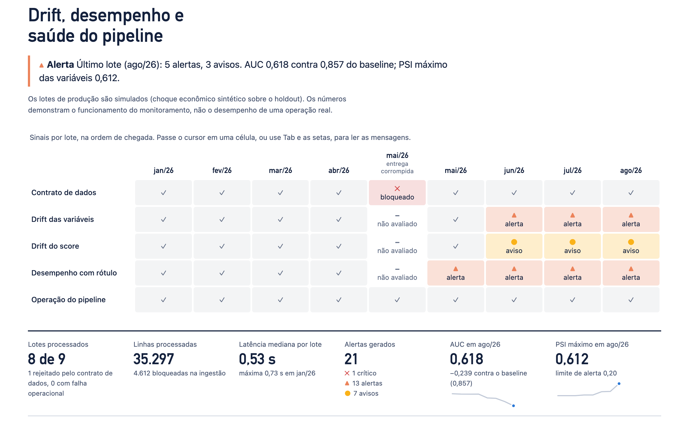
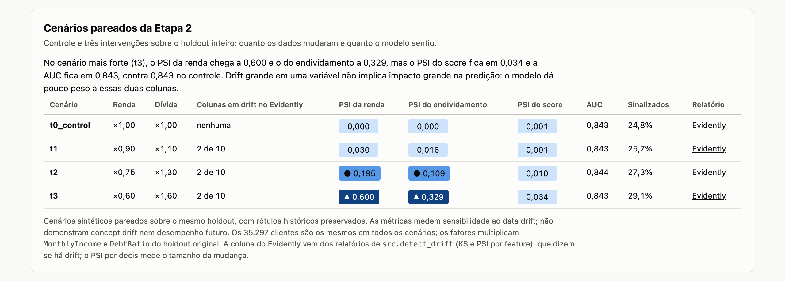
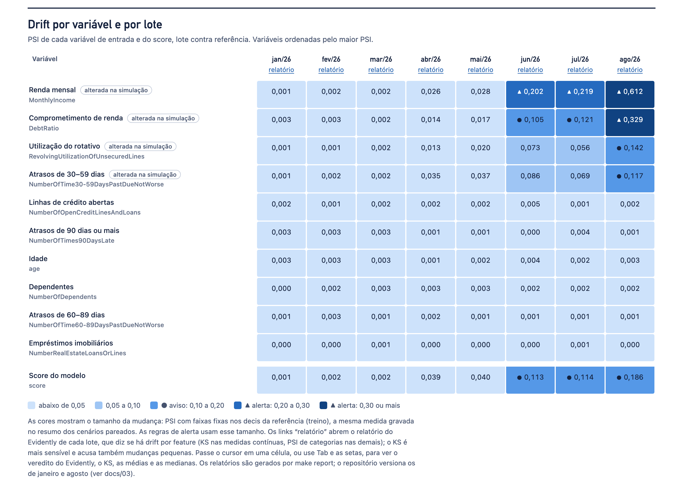
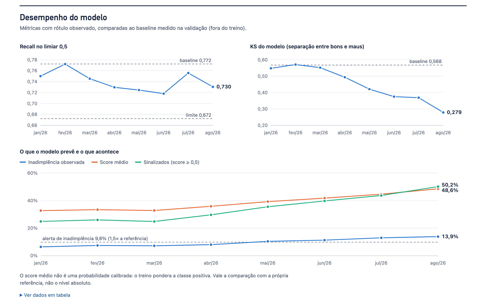
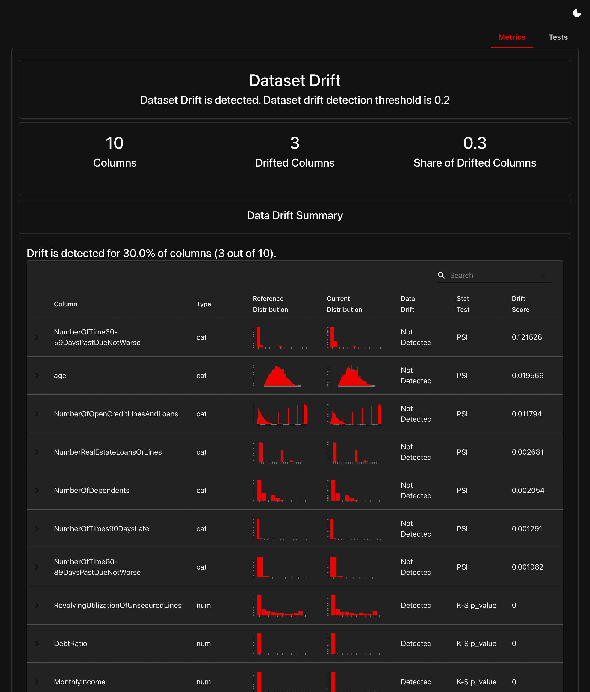
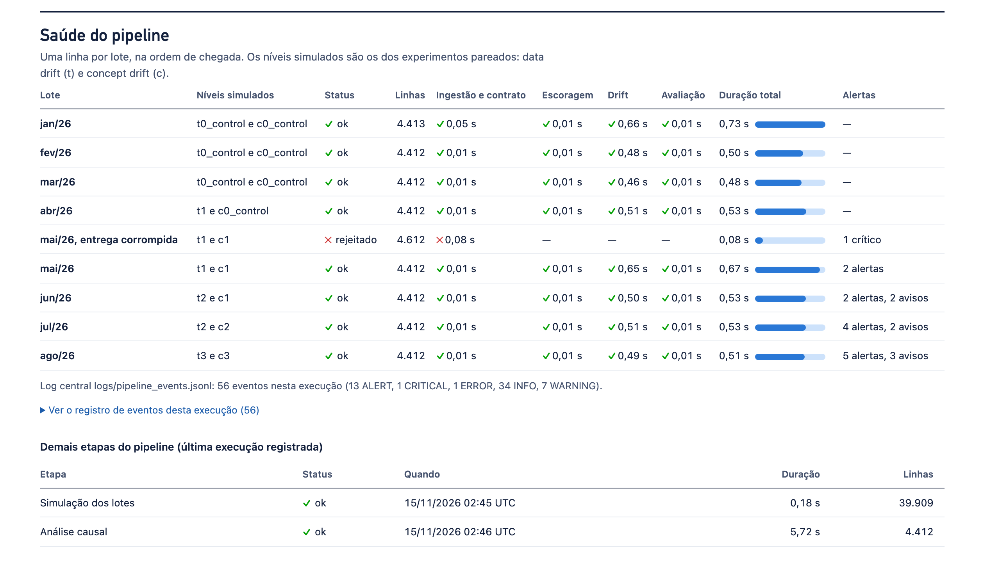

# TC04 | Drift, observabilidade e governança de um modelo de crédito

Projeto acadêmico da Fase 4 do MLET/FIAP. O cenário é uma fintech cujo modelo de Credit Scoring pode sofrer degradação silenciosa diante de mudanças econômicas e do perfil dos clientes. O objetivo é validar dados, investigar mudanças de distribuição e definir como proteger dados e responder à degradação.

Este README documenta as **Etapas 1 a 3 executadas, com artefatos e evidências versionados** (contrato de dados; experimentos de data drift e de concept drift, com predições e relatórios; monitoramento por lote com observabilidade), e a **proposta de governança da Etapa 4**. A degradação de desempenho demonstrada é sintética; não representa uma série temporal real ou evidência de causa econômica. As políticas de operação futura são distinguidas dos controles executados; não constituem evidência de conformidade integral. Os lotes de produção são **simulados**: os resultados demonstram o funcionamento do monitoramento, não o desempenho de uma operação real. O projeto não realiza concessões reais de crédito.

### Resultado em resumo

- **Baseline** (XGBoost, validação fora do treino): AUC 0,857, recall 0,772 no limiar 0,5 e KS 0,568.
- **Três experimentos complementares sobre o holdout**. Os **cenários pareados** `t0` a `t3` mantêm os mesmos 35.297 clientes e rótulos e alteram renda e endividamento por fatores fixos. O **experimento de concept drift** `c0` a `c3` mantém features e scores e altera o rótulo no segmento de menor renda. Os **lotes mensais** repartem o holdout em 8 meses com um choque econômico progressivo, que combina as duas mudanças, e trazem uma entrega corrompida. O contrato **bloqueou a entrega corrompida** (4.612 linhas) e deixou passar os dados com drift, que são válidos e apenas mudaram de distribuição.
- **Drift nos cenários pareados**: o Evidently aponta renda e endividamento em `t1`, `t2` e `t3`, e nada no controle. Em magnitude, o PSI da renda vai de 0,030 em `t1` a 0,600 em `t3`, mas o score quase não se move (PSI 0,034) e a AUC fica em 0,843. Drift grande em uma variável de pouco peso tem impacto pequeno.
- **Drift detectado nos lotes mensais**: as 4 variáveis alteradas chegaram a PSI entre 0,246 e 0,429 no último mês; as 6 não alteradas ficaram em no máximo 0,005 em todos os meses.
- **Degradação silenciosa**: a AUC já tinha caído 0,078 em maio, quando nenhum PSI passava de 0,10. O primeiro aviso de PSI veio em junho e o primeiro alerta em julho. O teste KS, mais sensível, já acusava as variáveis alteradas em abril.
- **Concept drift pareado**: com features e scores idênticos linha a linha, alterar o rótulo no segmento de menor renda derruba a AUC de 0,843 para 0,670 e o recall de 74,1% para 45,4% em `c3`. Nenhum monitor de entradas ou de scores vê essa mudança.
- **Decomposição nos lotes mensais** (experimento contrafactual): a mudança na relação entre variáveis e inadimplência derruba a AUC em 0,189; a mudança só nos dados, em 0,064, mas dobra a parcela de clientes sinalizados (24% para 50%).
- **Observabilidade**: 58 eventos no log central da execução, 23 alertas (1 crítico, 17 alertas, 5 avisos), métricas por lote no MLflow e um [dashboard HTML](reports/dashboard.html) autocontido.



O GitHub não renderiza HTML: para navegar no dashboard, baixe o repositório e abra `reports/dashboard.html` no navegador.

## 1. Escopo e evidências disponíveis

| Componente | Evidência no repositório | Situação |
| --- | --- | --- |
| Exploração e avaliação inicial de seleção | [Notebook](notebooks/01_exploracao.ipynb) | Exploração auxiliar; saídas antigas removidas; leitura sem modificar dados |
| Limpeza e separação treino/validação/produção | [prepare.py](src/prepare.py), relatório de limpeza e arquivos Parquet | Implementados; percentis ajustados somente no treino; divisão aleatória (a passagem do tempo é simulada à parte, sobre o holdout) |
| Contrato de dados | [contract.py](src/contract.py) | Implementado em Pandera |
| Bloqueio e quarentena | [ingest.py](src/ingest.py) | Implementados para falhas de validação do contrato |
| Lotes de demonstração | [Log de aprovação](artifacts/stage1/20261114T201315-0300-5fbfe64d/06_ingest_good.txt), [log de bloqueio](artifacts/stage1/20261114T201315-0300-5fbfe64d/07_ingest_bad.txt) e [falhas](data/quarantine/bad_batch_errors.csv) | Executados: 500 linhas aprovadas e lote de 505 linhas em quarentena |
| Treinamento e avaliação | [Modelo](models/runs/32542e11c8c8477ea23d42db115efd0e/model.joblib), [métricas](models/runs/32542e11c8c8477ea23d42db115efd0e/metrics.json) e [manifesto da execução](artifacts/stage1/20261114T201315-0300-5fbfe64d/manifest.json) | Baseline treinado, métricas conferidas após recarregar o modelo e publicação por versão |
| Simulação de data drift | [simulate_drift.py](src/simulate_drift.py): controle e três períodos sintéticos pareados a partir do holdout | Implementada; não representa série temporal real |
| Predições da Etapa 2 | [predict.py](src/predict.py): inferência com o modelo salvo na referência e nos quatro cenários | Implementadas; probabilidades e classes em arquivos separados |
| Detecção de data drift | [detect_drift.py](src/detect_drift.py), [resumo estatístico](reports/drift/summary.csv) e relatórios HTML do Evidently | Executada: controle sem detecção; renda e dívida com drift em t1, t2 e t3 |
| Concept drift e comportamento do modelo | [concept_drift.py](src/concept_drift.py), [análise](artifacts/concept_drift/analysis.html) e [métricas](artifacts/concept_drift/metrics.csv) | Executados: alteração condicional do alvo, features e modelo fixos, avaliação global e por segmento e sensibilidade a cinco seeds |
| Simulação em lotes mensais | [simulate_batches.py](src/simulate_batches.py); parâmetros e seed no [resumo do monitoramento](reports/monitoring_summary.json) | Executada: 8 lotes com choque progressivo (data drift e concept drift) e 1 entrega corrompida |
| Magnitude e impacto do drift nos cenários | [scenario_impact.py](src/scenario_impact.py) e [resumo](reports/scenario_impact.json) | Executada: PSI por decis, PSI do score e métricas do modelo em cada cenário |
| Drift por lote | [batch_drift.py](src/batch_drift.py), [drift_stats.py](src/drift_stats.py) e relatórios do Evidently de [jan/26](reports/batches/2026-01.html) e [ago/26](reports/batches/2026-08.html) | Executado: PSI por decis e KS por variável e para o score, lote contra referência |
| Monitoramento e alertas | [monitor.py](src/monitor.py), [alerts.py](src/alerts.py) e [resumo](reports/monitoring_summary.json) | Executados sobre os lotes simulados: 23 alertas em 9 lotes |
| Observabilidade centralizada | [observability.py](src/observability.py), [tracking.py](src/tracking.py), [dashboard.py](src/dashboard.py) e [dashboard](reports/dashboard.html) | Log central de eventos, MLflow local e dashboard HTML; sem agendador nem envio externo de alertas |
| Análise causal | [causal_analysis.py](src/causal_analysis.py) e [resultado](reports/causal_analysis.json) | Experimento contrafactual sobre a simulação; não identifica a causa de uma degradação real |
| Governança | Este README | Política proposta e hipóteses documentadas |
| Vídeo STAR | Seção 10 | Gravação e link pendentes |

## 2. Dados, modelo e arquitetura

### Dados e finalidade

Os arquivos locais correspondem ao conjunto **Give Me Some Credit**, com 150.000 registros no `cs-training.csv`. A finalidade acadêmica é estimar o risco de inadimplência e estudar qualidade e confiabilidade. A origem de obtenção, a versão e os termos de uso devem ser registrados antes da entrega; a presença dos arquivos no Git não comprova autorização de redistribuição.

O alvo `SeriousDlqin2yrs` representa inadimplência grave no horizonte de dois anos. As dez variáveis preditoras são:

| Grupo | Colunas | Risco de privacidade e uso |
| --- | --- | --- |
| Perfil | `age`, `NumberOfDependents` | Combinações podem favorecer identificação e segmentação discriminatória |
| Situação financeira | `MonthlyIncome`, `DebtRatio`, `RevolvingUtilizationOfUnsecuredLines` | Informações financeiras confidenciais; possíveis proxies socioeconômicos |
| Histórico de crédito | `NumberOfTime30-59DaysPastDueNotWorse`, `NumberOfTimes90DaysLate`, `NumberOfTime60-89DaysPastDueNotWorse`, `NumberOfOpenCreditLinesAndLoans`, `NumberRealEstateLoansOrLines` | Perfil financeiro e risco de exposição de comportamento |
| Desfecho | `SeriousDlqin2yrs` | Informação de inadimplência; usada no treino e na avaliação |

Não há colunas de nome, CPF, telefone ou e-mail no arquivo de treino inspecionado. A coluna `Unnamed: 0`, um índice do arquivo, é removida na preparação. **Essa remoção não comprova anonimização**: não há avaliação de reidentificação ou técnica de anonimização implementada.

Dados financeiros e idade podem ser dados pessoais quando vinculados a pessoa identificada ou identificável; não são automaticamente dados pessoais sensíveis na definição legal. Não foram identificadas colunas explícitas de saúde, biometria, religião ou origem racial. A distinção segue o [Glossário da ANPD](https://www.gov.br/anpd/pt-br/documentos-e-publicacoes/glossario-anpd).

### Fluxo implementado

```text
data/raw/cs-training.csv
    -> src.prepare: limpeza fixa + divisões estratificadas (seed 42)
        -> treino (56%): ajusta os dois limites p99
        -> aplica os mesmos limites ao treino, validação (14%) e holdout (30%)
        -> data/reference/reference.parquet (somente treino)
        -> data/validation/validation.parquet
            -> src.train: valida contratos das duas partições
                -> treino XGBoost na referência e avaliação na validação
                -> models/.tmp-<execução>/{model.joblib,metrics.json}
                -> models/runs/<execução> (versão completa)
                -> models/current (apontador para a versão publicada)
        -> data/reference/outlier_limits.json + cleaning_report.json
        -> data/production/holdout.parquet
            -> src.make_bad_batch: lotes de demonstração
                -> data/incoming/{good,bad}_batch.parquet
                    -> src.ingest + contrato Pandera
                        -> válido: log e retorno 0
                        -> inválido: movimentação para data/quarantine,
                           CSV de falhas e retorno 1
                        -> falha operacional: log e retorno 2
            -> src.simulate_drift: controle e intervenções pareadas em renda/dívida
                -> data/production/scenarios/{t0_control,t1,t2,t3}.parquet
                -> data/production/scenarios/manifest.json

models/current/model.joblib + referência + quatro cenários
    -> src.predict: contrato + seleção ordenada de FEATURE_COLUMNS
        -> data/predictions/{reference,t0_control,t1,t2,t3}.parquet
        -> data/predictions/manifest.json

referência + quatro cenários (somente FEATURE_COLUMNS)
    -> src.detect_drift: Evidently DataDriftPreset + KS/PSI
        -> reports/drift/{t0_control,t1,t2,t3}.{html,json}
        -> reports/drift/summary.csv + manifest.json

referência (ajusta apenas corte de renda) + holdout + modelo salvo
    -> src.concept_drift: altera Y condicionalmente a X; preserva X e modelo
        -> artifacts/concept_drift/{datasets,predictions}/
        -> métricas globais e por segmento + sensibilidade a cinco seeds
        -> relatórios de classificação do Evidently + prova de features estáveis
        -> analysis.html + interventions.parquet + manifest.json

referência + quatro cenários + models/current
    -> src.scenario_impact: PSI por decis, PSI do score e métricas do modelo
        -> reports/scenario_impact.json

data/production/holdout.parquet
            -> src.simulate_batches: 8 lotes mensais + 1 entrega corrompida (seed 42)
                -> data/production/batches/*.parquet + manifest.json
                    -> src.monitor, para cada lote na ordem de chegada:
                        -> contrato (src.ingest): inválido vai para
                           data/quarantine/<execução>/ e o lote é interrompido
                        -> escoragem com models/current
                        -> src.batch_drift: Evidently, PSI por decis + KS
                           -> reports/batches/<lote>.html
                        -> desempenho com o rótulo observado
                        -> src.alerts: regras de alerta
                        -> um evento por etapa em logs/pipeline_events.jsonl
                           e métricas por lote no MLflow (mlflow.db)
                    -> reports/monitoring_summary.json
            -> src.causal_analysis -> reports/causal_analysis.json

resumos + log central
    -> src.dashboard -> reports/dashboard.html
```

[config.py](src/config.py) centraliza alvo, seed, limiar de classificação, fatores dos períodos, critérios de drift e probabilidades do choque sintético no alvo, além dos caminhos e dos limiares de alerta do monitoramento. [artifacts.py](src/artifacts.py) centraliza snapshots de leitura e hashes SHA-256 usados nos experimentos e relatórios. A ordem das features continua definida apenas em [contract.py](src/contract.py).

Os percentuais são anteriores à filtragem de outliers; as proporções finais podem variar. Os scripts criam os diretórios de saída automaticamente. A preparação atual já foi executada; ao reproduzir, executar `python -m src.prepare` antes de treinar para manter as partições e os limites da mesma preparação. Na demonstração da Etapa 1 (`src.ingest` pela linha de comando), a ingestão aprovada somente valida o lote. No monitoramento (`src.monitor`), o lote aprovado segue para escoragem, drift e avaliação, e o rejeitado é interrompido antes de chegar ao modelo. O treinamento valida referência e validação com o contrato e exige registros das duas classes em ambas antes de criar o modelo. Reprovação retorna 1; falha operacional retorna 2. Uma execução bloqueada preserva eventuais artefatos anteriores.

Modelo e métricas são gravados em um diretório temporário exclusivo dentro de `models/`. Somente após concluir ambas as gravações, a versão é movida para `models/runs/<execução>` e o link simbólico `models/current` é substituído atomicamente. Os caminhos publicados são `models/current/model.joblib` e `models/current/metrics.json`. Falhas de gravação ou publicação retornam 2 e preservam a versão anterior; temporários e versões não publicadas são removidos nas falhas tratadas. Versões publicadas anteriores permanecem disponíveis em `models/runs/`.

Para ler modelo e métricas da mesma execução enquanto houver novos treinamentos, resolver o apontador uma única vez com `run_dir = Path("models/current").resolve()` e abrir ambos a partir de `run_dir`. Todos os consumidores do projeto usam a estrutura publicada em `models/current` ou uma versão explícita de `models/runs`. O monitoramento, o impacto dos cenários e a análise causal resolvem `models/current` uma vez, leem modelo e métricas do mesmo diretório e gravam a versão usada no resumo. A publicação por links simbólicos foi validada no macOS e requer suporte do filesystem a esses links.

O modelo é um `XGBClassifier` com 300 estimadores, profundidade 4, taxa de aprendizado 0,05 e ponderação da classe positiva. A avaliação calcula AUC ROC, recall com limiar 0,5 e KS como separação máxima entre TPR e FPR. **Esse KS de classificação não é um teste de drift entre datasets.** O limiar 0,5 é usado na avaliação; uma política de aprovação de crédito não foi implementada.

## 3. Qualidade de dados e limites do contrato

O contrato exige pelo menos um registro; valores finitos em todas as colunas numéricas (rejeita `+inf` e `-inf`); alvo binário; idade inteira entre 18 e 100, inclusive; renda não nula e não negativa; demais medidas e contagens não negativas; colunas e tipos definidos; ausência de colunas extras e de linhas integralmente duplicadas. Os campos não marcados como anuláveis também rejeitam nulos por padrão. Não há coerção de tipos configurada. Lotes vazios e números infinitos são violações do contrato, com retorno 1 na ingestão e no treinamento.

A lista `FEATURE_COLUMNS`, definida no contrato, determina a ordem das entradas do modelo. O treinamento seleciona as mesmas features nessa ordem na referência e na validação, permitindo arquivos com colunas em outra ordem. A lista fica registrada também nos nomes das features do XGBoost serializado.

A preparação remove duplicatas, idades fora do intervalo, registros sem renda ou dependentes, rendas negativas e códigos 96/98 nas colunas de atraso. Separa 30% para holdout e divide os 70% restantes em treino/validação na proporção 80/20. Calcula os percentis 99 de `DebtRatio` e de utilização de crédito exclusivamente no treino, antes de qualquer filtro estatístico. Aplica os mesmos limites às três partições, sem recalculá-los na validação ou no holdout. Os limites são salvos em `data/reference/outlier_limits.json`, e o relatório registra exclusões e tamanhos por partição.

O [relatório da preparação executada](data/reference/cleaning_report.json) registra 609 duplicatas, 14 exclusões por idade, 29.214 por renda/dependentes ausentes, nenhuma por renda negativa e 145 pelos códigos 96/98. Restaram 120.018 registros antes dos filtros estatísticos. Os limites calculados somente no treino foram `DebtRatio ≤ 672,76` e `RevolvingUtilizationOfUnsecuredLines ≤ 1,09213079212`; os valores completos estão em [outlier_limits.json](data/reference/outlier_limits.json).

| Partição | Antes dos outliers | Removidos por DebtRatio | Removidos por utilização | Registros finais |
| --- | ---: | ---: | ---: | ---: |
| Treino / referência | 67.209 | 673 | 669 | 65.867 |
| Validação | 16.803 | 156 | 167 | 16.480 |
| Holdout | 36.006 | 366 | 343 | 35.297 |

As exclusões são contagens sequenciais, não estimativas independentes de prevalência. Ao final, restaram 117.644 registros nas três partições. A execução verificou contratos, limites aplicados e ausência de registros compartilhados entre partições.

Limitações que precisam orientar a operação:

- O contrato exige `SeriousDlqin2yrs`; atende lotes históricos rotulados. Inferência real exige contrato próprio sem o alvo, pois o desfecho futuro ainda não é conhecido. Os lotes simulados da seção 7 já chegam rotulados, como se o desfecho tivesse maturado.
- O contrato não reproduz todos os filtros da limpeza: não bloqueia especificamente 96/98 nem aplica limites superiores de renda, dívida ou utilização.
- A remoção de outliers também filtra validação e holdout; as métricas descrevem a população retida. O relatório permite acompanhar as exclusões por partição. A simulação atual não reaplica esse filtro após as intervenções, preservando as mudanças introduzidas.
- O lote ruim contém idade 15, renda nula, dívida negativa, duplicatas e coluna ausente. Isso testa qualidade, não simula drift temporal. Os cenários pareados e os lotes mensais com drift passam no contrato, porque são dados válidos com outra distribuição; quem pega esse caso é a detecção de drift.
- A ingestão retorna 2 para falhas de leitura, validação inesperada, escrita ou movimentação. Se já houver lote ou relatório com o mesmo nome na quarentena, preserva a evidência anterior e o arquivo de entrada e retorna 2; é necessário resolver a colisão antes de repetir. No monitoramento, cada execução grava a quarentena em `data/quarantine/<execução>/`, o que evita a colisão; a demonstração da Etapa 1 mantém o comportamento descrito.

## 4. Plano de proteção de dados e base legal

### Finalidades e enquadramento

Na hipótese de operação real da fintech, a base legal proposta para avaliação de risco é **proteção do crédito, art. 7º, X, da LGPD**. O controlador deverá validar sua adequação à finalidade e aos dados tratados. Essa hipótese não autoriza automaticamente o reuso acadêmico ou a publicação da base. Finalidade acadêmica também exige observar os arts. 7º e 11, conforme art. 4º, II, b. Fonte: [texto atualizado da LGPD](https://www2.camara.leg.br/legin/fed/lei/2018/lei-13709-14-agosto-2018-787077-normaatualizada-pl.html).

Para este estudo, permanece pendente documentar a procedência, os termos de uso e o enquadramento do tratamento. O caráter público de uma fonte não afasta, por si só, os cuidados com dados pessoais. Fonte: [perguntas frequentes da ANPD](https://www.gov.br/anpd/pt-br/acesso-a-informacao/perguntas-frequentes).

### Privacy by Design e by Default

| Medida | Situação atual | Política proposta |
| --- | --- | --- |
| Minimização | Remoção do índice; contrato recusa colunas extras | Admitir somente atributos justificados pela finalidade; não incluir identificadores diretos nas features |
| Segregação | Diretórios de dados brutos, referência e holdout | Separar ambientes, identidades e permissões; manter chaves de associação fora da área analítica |
| Acesso | Sem controle de acesso implementado no projeto | Menor privilégio; dados detalhados restritos à equipe autorizada; revisão ao trocar integrantes |
| Armazenamento e transporte | Arquivos locais; sem configuração de criptografia no código | Armazenamento e backups criptografados; TLS nas transferências; segredos fora do Git |
| Publicação | CSV e Parquet estão versionados | Avaliar termos e risco; preferir amostras sintéticas e resultados agregados; tratar histórico Git se houver remoção necessária |
| Logs e relatórios | Log central, resumo do monitoramento, MLflow e dashboard gravam somente agregados por lote (um teste verifica que valores rejeitados não chegam ao log); o CSV de falhas da quarentena contém valores e, no monitoramento, fica fora do Git | Não registrar linhas de clientes; restringir quarentena e sanitizar valores antes de compartilhar relatórios ou vídeo |
| Descarte | Sem rotina implementada | Aplicar a tabela de retenção, incluindo cópias, backups e histórico sob controle da equipe |

O CSV de falhas pode conter valores rejeitados. Quarentena é uma área restrita de diagnóstico, não um mecanismo de anonimização. A ausência de identificadores diretos também não autoriza divulgar registros financeiros individuais.

### Direitos e decisões automatizadas

Em uma operação real, disponibilizar canal de privacidade para acesso, correção e demais solicitações aplicáveis; manter registro de atendimento. Solicitações de revisão de decisões automatizadas devem receber procedimento documentado, com informação sobre critérios e parâmetros, respeitados os segredos comercial e industrial. Fonte: [direitos dos titulares, ANPD](https://www.gov.br/anpd/pt-br/assuntos/titular-de-dados-1/direito-dos-titulares).

Como política do projeto para uma implantação futura, decisões contestadas ou com alerta crítico serão encaminhadas a análise humana, com justificativa registrada. O protótipo atual não possui cadastro de titulares, canal de atendimento ou sistema de decisão de crédito.

### Retenção e descarte

Os prazos abaixo são **propostas internas para o ambiente acadêmico**, contados conforme cada linha, e não prazos legais universais. Na operação real, o controlador deverá definir uma matriz própria de obrigações e necessidades antes da coleta.

| Categoria | Retenção proposta | Destino e responsável |
| --- | --- | --- |
| Dados brutos e derivados locais | Até 90 dias após a avaliação final | Engenharia de Dados elimina cópias de trabalho e confirma tratamento das cópias compartilhadas |
| Lotes em quarentena e CSVs com valores | Até 30 dias após a triagem | Engenharia de Dados corrige/reprocessa ou elimina; guarda somente resumo agregado |
| Logs sem valores individuais | 180 dias após a execução | MLOps elimina após consolidar indicadores de auditoria |
| Relatórios agregados e documentação | 12 meses após a avaliação final | Responsável pelo projeto revisa necessidade de conservação |
| Modelos e metadados | Até 12 meses após a substituição | Ciência de Dados elimina versões sem necessidade de auditoria; acesso continua restrito |

Revisar mensalmente os vencimentos; registrar categoria, data, executor e resultado do descarte. Incluir backups no ciclo de expiração. Exceções exigem motivo, aprovador e nova data de revisão. Um arquivo excluído da pasta de trabalho pode continuar no Git ou em clones: a limpeza do histórico e o alcance das cópias precisam ser avaliados separadamente. Nada disso está automatizado hoje.

## 5. Vieses e uso responsável

O dataset de treino tem 10.026 positivos em 150.000 registros, uma taxa de 6,684%. O treinamento usa `scale_pos_weight` para lidar com o desequilíbrio; isso não demonstra equidade entre grupos.

A exclusão de registros sem renda ou dependentes pode mudar a população atendida. A análise do CSV bruto, reproduzível pelo notebook auxiliar, encontra taxas de inadimplência de aproximadamente 5,61% para renda ausente e 6,95% para renda preenchida, indicando seleção potencialmente relevante. Os filtros de percentil também podem remover clientes de maior risco. Esses resultados justificam investigação, sem comprovar discriminação ou causalidade.

A simulação acrescenta um risco de uso responsável: quando só as variáveis mudam (renda menor, mais uso do rotativo), o modelo passa a sinalizar o dobro dos clientes sem que a inadimplência deles tenha mudado (seção 6). Em uma operação real isso significaria recusas indevidas concentradas em quem perdeu renda. O monitoramento implementado é agregado por lote; a avaliação por segmento descrita abaixo continua pendente.

Antes de recomendar uso operacional, a política proposta é:

1. Comparar proporções de exclusão, distribuição e inadimplência antes/depois da limpeza por faixas de idade e renda.
2. Avaliar AUC, recall, FPR, FNR e calibração por segmento, com tamanho amostral e incerteza; explicitar que o positivo representa inadimplência.
3. Comparar exclusão de renda ausente com imputação ajustada no treino e indicador de ausência, avaliando desempenho e seleção.
4. Revisar o uso de idade, dependentes e proxies socioeconômicos; justificar necessidade e alternativas.
5. Aprovar o limiar com base nos custos de inadimplência e de recusa indevida. Não converter automaticamente a probabilidade em aprovação/reprovação sem política validada.

Não há atributos explícitos suficientes para auditar todos os grupos protegidos. Sua ausência limita conclusões sobre equidade. Eventual coleta para auditoria exige finalidade, base legal e controles próprios; não deve ser feita indiscriminadamente.

## 6. Causalidade: diagnóstico e hipóteses

**Não há evidência de degradação temporal real nem de causa econômica observada.** O dataset não tem datas, e o holdout é uma amostra aleatória; o gerador de lote ruim introduz violações de contrato. O que existe são **experimentos controlados** sobre o holdout: os cenários pareados de `src.simulate_drift`, que alteram só duas variáveis; o experimento de `src.concept_drift`, que altera só o rótulo de um segmento, com as features fixas; e os lotes mensais de `src.simulate_batches` (seção 7), que combinam as duas mudanças ao longo do tempo. Os dois primeiros estão descritos mais abaixo. Em todos, as diferenças de métricas podem ser atribuídas à intervenção programada, dentro do experimento. A análise a seguir mede o efeito de cada intervenção dos lotes mensais. Isso mostra como o diagnóstico seria conduzido e quanto cada mecanismo pesa no cenário construído; não prova o que aconteceria com clientes reais.

### Experimento contrafactual nos lotes mensais

[causal_analysis.py](src/causal_analysis.py) pega os 4.412 clientes do último lote mensal e aplica cada parte do choque isoladamente, com o mesmo sorteio (seed) e o mesmo modelo. Como nada mais muda entre os cenários, a diferença é o efeito da intervenção. O intervalo de confiança vem de bootstrap pareado sobre os clientes (300 reamostragens).

| Cenário | O que muda | AUC | Efeito na AUC (IC 95%) | Recall | Sinalizados | Inadimplência |
| --- | --- | ---: | --- | ---: | ---: | ---: |
| Controle | Nada | 0,829 | — | 0,715 | 24,4% | 6,4% |
| Só P(X), data drift | Variáveis alteradas, rótulos originais | 0,765 | −0,064 [−0,078; −0,047] | 0,826 | 50,2% | 6,4% |
| Só P(Y\|X), concept drift | Rótulos alterados, variáveis originais | 0,640 | −0,189 [−0,219; −0,164] | 0,436 | 24,4% | 13,9% |
| Choque completo | Os dois | 0,691 | −0,138 [−0,160; −0,115] | 0,730 | 50,2% | 13,9% |


Leitura, válida dentro da simulação:

- **O concept drift é o que mais destrói a ordenação** (−0,189 de AUC). Ele não aparece em nenhum PSI: as variáveis e o score continuam com a distribuição do controle (PSI do score 0,002). Só o rótulo maturado o revela. O experimento pareado de concept drift, descrito mais abaixo, chega à mesma conclusão por outro desenho: com features e scores idênticos, a AUC vai de 0,843 para 0,670.
- **O data drift sozinho custa menos AUC (−0,064), mas dobra a parcela sinalizada** (24,4% para 50,2%) com a inadimplência inalterada. O recall sobe porque o modelo sinaliza muito mais gente, não porque acerta melhor. É o mesmo tipo de intervenção dos cenários pareados, que também preservam os rótulos, com a diferença de que aqui mudam variáveis de maior peso no modelo.
- **Os efeitos não se somam**: −0,064 −0,189 daria −0,253, e o choque completo derruba −0,138. A interação de +0,114 vem da construção do cenário: a mesma variável latente de estresse piora as variáveis e gera as novas inadimplências, então parte de quem passou a inadimplir também teve o score elevado.
- **Por variável** (só X, uma intervenção por vez): utilização do rotativo −0,026 de AUC e +0,081 no score médio; atrasos de 30–59 dias −0,019 e +0,053; `DebtRatio` −0,005 e +0,029; renda −0,002 e +0,009. O modelo é mais sensível às variáveis de maior importância (utilização 0,28; atrasos de 30–59 dias 0,20). A renda, apesar de um PSI de 0,379, quase não move o score: a importância dela no modelo é menor que 0,05. Drift grande em uma variável não implica impacto grande na predição.

Limites: as intervenções são sintéticas e definidas por nós ([parâmetros](src/simulate_batches.py)); o mecanismo real pode ser outro. Efeito medido em um cenário construído não é estimativa causal sobre dados observacionais, que exigiria dados temporais, controle de fatores de confusão e um desenho defensável.

### Hipóteses para uma degradação real

O mecanismo econômico a investigar é: mudança econômica pode afetar renda e endividamento, que podem alterar o risco de inadimplência; mudanças no público atendido e na política de aprovação também podem alterar a população observada. Essas relações são hipóteses de domínio, não conclusões obtidas neste projeto.

| Hipótese | Evidência necessária | Ação se corroborada |
| --- | --- | --- |
| Erro na coleta ou transformação | Falhas no contrato, mudança de unidade, versão da fonte e logs | Bloquear lote, corrigir origem e reprocessar |
| Data drift: mudança em P(X) | Comparação referência/análise, por exemplo em renda e endividamento, com testes e magnitude (implementada: PSI e KS por lote, seção 7) | Investigar origem, população e impacto sobre predições |
| Concept drift: mudança em P(Y\|X) | Rótulos maturados, queda de desempenho/calibração em condições comparáveis e análise de alternativas | Avaliar recalibração ou retreinamento |
| Seleção causada pela limpeza | Comparação entre incluídos/excluídos e alternativas de tratamento | Rever filtros e repetir avaliação por segmento |
| Efeito econômico sobre inadimplência | Dados temporais, fatores de confusão e desenho causal defensável | Submeter a hipótese a análise específica antes de atribuir causa |

PSI ou um teste KS de duas amostras pode apontar mudança de distribuição; não identifica sua causa nem comprova concept drift. Queda de performance também exige investigar qualidade, seleção, mudança de política e maturação do alvo.

O experimento de data drift registra intervenções em duas features e sua intensidade, compara cenários pareados e executa o mesmo modelo. Essa simulação usa todo o holdout sem aleatoriedade. O experimento separado de concept drift usa sorteios reproduzíveis para alterar o mecanismo do alvo. A seed 42 também se aplica à preparação e ao treinamento. Alterar apenas X mantendo rótulos antigos permite estudar sensibilidade das previsões, mas não demonstra desempenho real após uma mudança econômica; a alteração de `P(Y|X)` está explicitada na subseção de concept drift e, combinada com data drift em lotes mensais, na seção 7.

Como o alvo tem horizonte de dois anos, produção real requer política de maturação e acompanhamento de rótulos. Sem desfechos disponíveis, monitorar dados e scores e declarar a limitação de avaliação do modelo. O dataset local não permite reconstruir uma série temporal real de concessões.

### Cenário de controle e períodos sintéticos da Etapa 2

**O dataset não fornece uma série temporal real.** `t0`, `t1`, `t2` e `t3` são rótulos de cenários ordenados de um experimento, sem datas observadas, duração em meses ou alegação de evolução econômica real. Todos reutilizam os mesmos registros do holdout, na mesma ordem, para uma comparação pareada que mantém fixa a composição da amostra. Não representam safras independentes de clientes.

O script [simulate_drift.py](src/simulate_drift.py) lê `data/production/holdout.parquet` e gera:

| Arquivo em `data/production/scenarios/` | Cenário | Fator de MonthlyIncome | Fator de DebtRatio |
| --- | --- | ---: | ---: |
| `t0_control.parquet` | Controle: cópia integral do holdout, sem alterações de valores | 1,00 | 1,00 |
| `t1.parquet` | Primeira intervenção sintética | 0,90 | 1,10 |
| `t2.parquet` | Segunda intervenção sintética | 0,75 | 1,30 |
| `t3.parquet` | Terceira intervenção sintética | 0,60 | 1,60 |

Cada fator é aplicado diretamente ao holdout original, sem acumular intervenções entre períodos. São parâmetros ilustrativos para reduzir renda e aumentar endividamento; não são estimativas econômicas nem recalculam contabilmente `DebtRatio` a partir da renda. Valores zero permanecem zero. Todas as demais features e o alvo histórico `SeriousDlqin2yrs` são preservados. Manter esses rótulos após alterar as features permite estudar sensibilidade, mas não comprova concept drift nem desempenho futuro real.

O controle não recebe intervenção; isso não garante ausência de diferenças estatísticas em relação ao treino. O holdout já passou pela limpeza da Etapa 1. Não há nova filtragem por p99 após as intervenções, para não remover a mudança introduzida. O script valida a entrada e todos os cenários com o contrato Pandera antes de publicar os arquivos. A referência de treino, a validação, o holdout e o modelo permanecem intactos; não há treinamento nessa operação.

O `manifest.json` registra o caminho e o hash SHA-256 da entrada, fatores, número de registros, hashes dos arquivos gerados e limitações do experimento. O processo usa todo o holdout e não contém amostragem ou aleatoriedade; não requer seed. Metadados ficam no manifesto, fora dos Parquet, para preservar o contrato estrito.

Na execução local, cada cenário contém 35.297 registros e passa pelo contrato. O [manifesto gerado](data/production/scenarios/manifest.json) registra os artefatos. A verificação SHA-256 antes/depois confirmou que os sete arquivos de referência, validação, holdout e modelo/métricas não foram alterados. O controle também coincidiu integralmente com o holdout após a leitura dos Parquet.

Para gerar os cenários usando o holdout existente:

```bash
make simulate-drift PYTHON=.venv/bin/python
```

O alvo não depende de `prepare`, evitando regenerar a referência. Para outra entrada ou destino:

```bash
.venv/bin/python -m src.simulate_drift --holdout data/production/holdout.parquet --output-dir /tmp/tc04-scenarios
```

O destino deve ser inexistente; reexecuções não sobrescrevem cenários anteriores. Os quatro Parquet e o manifesto são publicados juntos após a gravação em diretório temporário. A inferência e a detecção estatística com Evidently estão descritas a seguir.

### Predições na referência e nos cenários

O script [predict.py](src/predict.py) carrega `models/current/model.joblib` uma única vez, resolvendo o apontador para a versão publicada, e executa o mesmo modelo na referência e em `t0_control`, `t1`, `t2` e `t3`. Não executa preparação ou treinamento e não altera os arquivos de entrada. Cada dataset é validado com Pandera. As entradas do modelo são selecionadas exclusivamente com `df.loc[:, FEATURE_COLUMNS]`, na ordem do contrato e sem o alvo; essa ordem também é conferida contra os nomes de features do modelo salvo.

```bash
make predict PYTHON=.venv/bin/python
```

Os resultados ficam em `data/predictions/{reference,t0_control,t1,t2,t3}.parquet`. Cada arquivo contém:

| Coluna | Significado |
| --- | --- |
| `row_position` | Posição da linha no Parquet de origem, começando em zero; nenhuma linha é removida ou reordenada |
| `SeriousDlqin2yrs` | Alvo histórico, copiado para permitir análises posteriores; não é entrada do modelo |
| `probability_0` | Probabilidade estimada para a classe 0 |
| `probability_1` | Probabilidade estimada para a classe 1 (inadimplência grave) |
| `predicted_class` | 1 quando `probability_1 >= 0.5`, e 0 caso contrário, seguindo o limiar da avaliação do baseline |

O `manifest.json` de predições registra a versão resolvida e o hash SHA-256 do modelo, horário UTC, ordem de features, regra de classificação, caminhos/hashes das entradas e hashes/quantidades das saídas. Para associar resultados às features, usar a posição das linhas no arquivo de origem indicado no manifesto e conferir seu hash. As predições ficam separadas dos dados para preservar o contrato estrito. O conjunto completo é publicado após concluir todos os arquivos; destino existente causa erro, preservando resultados anteriores.

Para outro destino ou uma versão explícita de modelo:

```bash
.venv/bin/python -m src.predict --model models/runs/32542e11c8c8477ea23d42db115efd0e/model.joblib --output-dir /tmp/tc04-predictions
```

Os argumentos `--reference` e `--scenarios-dir` também permitem indicar outras entradas. As predições na referência são sobre dados usados no treinamento, sem representar avaliação independente. Nos períodos sintéticos, os rótulos históricos permanecem inalterados; resultados não comprovam concept drift nem desempenho futuro real.

Na execução local com o modelo `32542e11c8c8477ea23d42db115efd0e`, foram salvas 65.867 predições na referência e 35.297 em cada cenário, totalizando 207.055. O [manifesto de inferência](data/predictions/manifest.json) registra a procedência. Após recarregar os cinco Parquet, probabilidades e classes coincidiram exatamente com uma nova inferência do modelo salvo; posições e rótulos também coincidiram com as entradas. Os hashes dos 12 arquivos de dados e modelo envolvidos permaneceram inalterados.

### Detecção de data drift com Evidently AI

O script [detect_drift.py](src/detect_drift.py) integra o Evidently **0.7.23** usando a API `Dataset`, `DataDefinition`, `Report` e `DataDriftPreset`, conforme a [documentação oficial de relatórios](https://docs.evidentlyai.com/docs/library/report) e de [métodos de drift](https://docs.evidentlyai.com/metrics/customize_data_drift). A execução é local, com telemetria de uso desabilitada por `DO_NOT_TRACK=1`. Não requer conta, servidor ou envio dos dados à plataforma Evidently.

```bash
make detect-drift PYTHON=.venv/bin/python
```

Cada cenário é comparado com `data/reference/reference.parquet`. Entrada e referência passam pelo contrato Pandera; somente `FEATURE_COLUMNS` são entregues ao Evidently. O alvo, `row_position`, probabilidades e classes previstas não participam dessa comparação. Os arquivos de inferência continuam disponíveis para análises posteriores de scores e desempenho, separadas da detecção de data drift.

Os métodos e limiares são explícitos em `src/config.py`, sem depender da seleção automática por cardinalidade do Evidently:

| Grupo | Features | Método | Critério por feature |
| --- | --- | --- | --- |
| Medidas financeiras contínuas | `MonthlyIncome`, `DebtRatio`, `RevolvingUtilizationOfUnsecuredLines` | KS de duas amostras | p-valor < 0,01 |
| Idade e contagens, tratadas como categorias | As outras sete features do contrato | PSI sobre frequências das categorias | PSI ≥ 0,20 |

O PSI categórico usa a união dos valores presentes nas duas amostras e o tratamento de frequências zero do Evidently 0.7.23; não discretiza renda ou dívida. O KS evita a escolha de bins para as medidas financeiras. O p-valor não mede a magnitude nem o impacto de negócio, e os testes podem ser sensíveis ao volume e a valores repetidos. Os limiares são escolhas iniciais do experimento, sem correção de múltiplas comparações; não são exigências do enunciado nem critérios universais. O critério global sinaliza drift quando **pelo menos 20% das dez features** apresentam drift; os resultados individuais continuam disponíveis mesmo abaixo desse percentual.

O diretório `reports/drift/` contém quatro relatórios HTML, quatro JSONs nativos do Evidently, `summary.csv` com as 40 comparações por feature e cenário e `manifest.json` com versões das bibliotecas, parâmetros, hashes das entradas/saídas e limitações. Nos relatórios, testes em falha indicam drift detectado, não falha operacional do script. Uma execução concluída retorna 0 mesmo com drift; erros de leitura, contrato ou geração propagam erro e não publicam um conjunto parcial. O destino deve ser inexistente. Para outro conjunto ou destino:

```bash
.venv/bin/python -m src.detect_drift --reference data/reference/reference.parquet --scenarios-dir data/production/scenarios --output-dir /tmp/tc04-drift
```

Resultados da execução sobre os artefatos preservados:

| Cenário | Features com drift | Proporção | Relatório |
| --- | --- | ---: | --- |
| Controle | Nenhuma | 0/10 | [t0_control.html](reports/drift/t0_control.html) |
| t1 | `MonthlyIncome`, `DebtRatio` | 2/10 | [t1.html](reports/drift/t1.html) |
| t2 | `MonthlyIncome`, `DebtRatio` | 2/10 | [t2.html](reports/drift/t2.html) |
| t3 | `MonthlyIncome`, `DebtRatio` | 2/10 | [t3.html](reports/drift/t3.html) |

No controle, os p-valores de renda e dívida foram aproximadamente 0,925 e 0,588; em t1, aproximadamente 1,01 × 10⁻¹²³ e 1,91 × 10⁻⁶⁰. Em t2 e t3, a biblioteca retornou 0 por precisão numérica para esses p-valores extremamente pequenos. Os números completos estão no [resumo estatístico](reports/drift/summary.csv) e a procedência no [manifesto](reports/drift/manifest.json). Os 54 arquivos existentes de dados, modelos e evidências permaneceram inalterados durante a geração, verificados por SHA-256.

A ausência de drift no controle é um resultado observado, sem garantia para outras amostras. A detecção em renda e dívida confirma mudanças de distribuição introduzidas no experimento; não comprova queda de desempenho, causa econômica ou concept drift. O experimento separado a seguir altera explicitamente `P(Y|X)`. A magnitude das mudanças de distribuição dos cenários `t1` a `t3` e o efeito delas no modelo estão na seção 7, em "Magnitude e impacto do drift nos cenários pareados".

### Experimento de concept drift e comportamento do modelo

[concept_drift.py](src/concept_drift.py) mantém **as mesmas features, os mesmos clientes, a mesma ordem, o mesmo modelo e o limiar 0,5** em quatro cenários. Altera somente o mecanismo do alvo histórico. A distinção entre mudanças em `P(X)` e em `P(Y|X)` segue a formulação de [Tan, Lee e Salehi (2019)](https://arxiv.org/abs/1909.11251); aqui a mudança condicional é conhecida por construção, não inferida somente pela mudança da prevalência.

O segmento afetado é `MonthlyIncome ≤ 3500`, corte ajustado no primeiro quartil **somente da referência de treino**. Inclui 9.147 registros do holdout (aproximadamente 25,9%; os empates no corte explicam a diferença para 25%). A hipótese ilustrativa é um choque adicional de inadimplência nesse segmento. Não há estimativa de inflação, desemprego ou efeito causal econômico.

Para cada linha, sortear `U ~ Uniforme(0,1)`, independente do modelo, com seed 42 e reutilizar o mesmo `U` nos quatro cenários. Com `S(X)` indicando o segmento e `Y0` o rótulo histórico:

```text
Yq = Y0 OU (S(X) E U < q)
Pq(Y=1|X) = p0(X) + (1 - p0(X)) * q * S(X)
```

`p0(X)` é a probabilidade histórica desconhecida, não o score do modelo. Apenas rótulos 0 no segmento podem virar 1; positivos históricos e rótulos fora do segmento permanecem intactos. Os valores de `q` são 0, 0,10, 0,25 e 0,50, definidos em `src/config.py`. São chances adicionais para os negativos elegíveis, não taxas finais de inadimplência. O uso dos mesmos sorteios torna as alterações cumulativas entre cenários. O mecanismo não usa scores nem ajusta parâmetros para obter determinada queda de métrica.

```bash
make concept-drift PYTHON=.venv/bin/python
```

O comando usa o holdout original, não os cenários de data drift, e publica um conjunto completo em `artifacts/concept_drift/`: datasets, predições, auditoria por linha em `interventions.parquet`, métricas globais e por segmento, sensibilidade a cinco seeds, quatro relatórios de classificação HTML/JSON do Evidently, comparação de features e manifesto com parâmetros, versões e hashes. Os [relatórios de classificação](https://docs.evidentlyai.com/metrics/preset_classification) usam o controle do mesmo holdout como referência, com gráficos ROC/PR e matrizes de confusão; a validação do treino não é usada como baseline desse experimento. Não há treinamento, recalibração ou mudança de limiar.

Resultados com seed 42, todos com 35.297 registros:

| Cenário | q | Rótulos alterados | Prevalência | AUC ROC | Recall | Precisão | Falsos negativos |
| --- | ---: | ---: | ---: | ---: | ---: | ---: | ---: |
| c0_control | 0 | 0 | 6,62% | 0,843257 | 74,09% | 19,74% | 605 |
| c1 | 0,10 | 815 | 8,92% | 0,768076 | 62,22% | 22,37% | 1.190 |
| c2 | 0,25 | 2.062 | 12,46% | 0,710069 | 52,49% | 26,34% | 2.089 |
| c3 | 0,50 | 4.123 | 18,30% | 0,669626 | 45,35% | 33,42% | 3.529 |

**Comportamento observado:** a probabilidade média prevista permanece 0,326790 e a proporção de classes positivas previstas permanece 24,83% em todos os cenários. As probabilidades e classes são idênticas linha a linha; o modelo não tem sinal de entrada que revele o choque. Mesmo assim, em c3 a AUC cai 0,173631 e o recall cai 28,74 pontos percentuais. O Brier piora de 0,147595 para 0,182354 e o log loss de 0,459707 para 0,553312. O KS de classificação cai de 0,533130 para 0,258752. As três intensidades ativam os critérios experimentais de queda absoluta de AUC ≥ 0,05 ou recall ≥ 0,10 em relação ao controle.

A precisão aumenta porque, dentro da mesma lista de previsões positivas, passam a existir mais positivos nos novos rótulos. O F1 também aumenta e a average precision de c3 fica próxima à do controle; essas métricas respondem à prevalência e não demonstram recuperação da discriminação. A ponderação de classes do baseline não garante probabilidades calibradas. Os resultados completos estão em [metrics.csv](artifacts/concept_drift/metrics.csv).

No segmento afetado, a AUC cai de 0,841789 para 0,548125 e o recall de 81,58% para 37,49%; a prevalência sobe de 8,60% para 53,68%. Fora dele, rótulos e todas as métricas permanecem iguais. Isso localiza o efeito na intervenção programada, sem transformá-la em evidência de vulnerabilidade real de um grupo. Ver [métricas por segmento](artifacts/concept_drift/segment_metrics.csv).

A sensibilidade usa as seeds 42–46 com os mesmos parâmetros e modelo. Em c3, a AUC varia de 0,669626 a 0,673019 e o recall de 44,75% a 45,84%, mantendo a degradação nas cinco realizações. Esses mínimos/máximos **não são intervalos de confiança** e não validam a hipótese econômica. Ver [sensitivity.csv](artifacts/concept_drift/sensitivity.csv).

A igualdade exata das features é verificada em todos os períodos. A [comparação Evidently entre c3 e o controle](artifacts/concept_drift/feature_drift.html) confirma zero features com drift. Monitorar apenas distribuições de entrada e scores não detectaria esse experimento: é necessário acompanhar rótulos maturados, desempenho e erros por segmento. A [análise consolidada](artifacts/concept_drift/analysis.html) reúne interpretação e links; o [manifesto](artifacts/concept_drift/manifest.json) registra a procedência. Os dados, modelo e relatórios anteriores permanecem intactos.

Para outra execução, escolher destino inexistente:

```bash
.venv/bin/python -m src.concept_drift --seed 43 --output-dir /tmp/tc04-concept-drift
```

Os argumentos `--reference`, `--holdout` e `--model` permitem indicar versões explícitas das entradas. Uma falha não publica resultados parciais; um destino existente é preservado. O experimento é um teste de estresse sintético, sem uma série temporal real e sem comprovar degradação do modelo em concessões reais. Em produção, o alvo de dois anos exige política de maturação. Antes de qualquer atualização operacional, investigar origem dos rótulos e comparar candidatos em dados independentes; nenhum modelo novo é promovido aqui.

## 7. Monitoramento e resposta à degradação

Esta seção separa o que está **implementado e executado sobre lotes simulados** do que continua como **política proposta**. Os limiares são pontos de partida, definidos em [config.py](src/config.py), e devem ser calibrados com dados reais; não são exigências do enunciado.

### Simulação da produção em lotes mensais (Etapa 2)

A seção 6 descreve os experimentos pareados, sempre com o holdout inteiro e os mesmos clientes: os cenários `t0` a `t3` isolam o data drift, e os cenários `c0` a `c3` isolam o concept drift. Esta seção acrescenta uma simulação complementar, que alimenta o monitoramento contínuo: o holdout chega em **lotes**, como chegaria em produção, o choque combina as duas mudanças e cresce no tempo, e uma entrega vem com defeito.

O dataset não tem datas. Para representar a passagem do tempo, [simulate_batches.py](src/simulate_batches.py) embaralha o holdout (35.297 clientes que o modelo nunca viu) e o reparte em 8 lotes mensais de cerca de 4.412 linhas, de 2026-01 a 2026-08. Os três primeiros ficam intactos, como período de controle. A partir do quarto, um choque econômico cresce em intensidade `t` = 0,2; 0,4; 0,6; 0,8; 1,0. A referência é sempre a partição de treino (`data/reference/`), separada da produção (`data/production/`).

O choque é dirigido por uma variável latente de estresse financeiro, que o modelo não observa. Com `t` = 1, metade das famílias entra em estresse, e:

| Tipo | Coluna | O que acontece |
| --- | --- | --- |
| Data drift, P(X) | `MonthlyIncome` | Perda real de 15% para todos; famílias em estresse ficam com 40% a 80% da renda |
| Data drift, P(X) | `DebtRatio` | A mesma parcela pesa sobre uma renda menor, com 15% de encarecimento |
| Data drift, P(X) | `RevolvingUtilizationOfUnsecuredLines` | Famílias em estresse consomem de 20% a 90% do limite que restava |
| Data drift, P(X) | `NumberOfTime30-59DaysPastDueNotWorse` | Metade das famílias em estresse ganha um ou mais atrasos |
| Concept drift, P(Y\|X) | `SeriousDlqin2yrs` | 15% dos bons pagadores em estresse passam a inadimplir, e 2% dos demais, sem sinal nas variáveis |

Duas das quatro variáveis alteradas estão entre as mais importantes do modelo (utilização do rotativo, 0,28; atrasos de 30–59 dias, 0,20). Tudo é determinístico (seed 42), e os parâmetros ficam gravados no manifesto dos lotes e no [resumo do monitoramento](reports/monitoring_summary.json). Em 2026-05 chega antes uma **entrega corrompida** do mesmo mês: 120 rendas nulas, 40 idades iguais a zero, 20 razões de dívida negativas e 200 linhas reenviadas em duplicidade.

### Drift por lote

Para cada lote aprovado, [batch_drift.py](src/batch_drift.py) gera um relatório do **Evidently** comparando a referência com o lote nas 10 variáveis de entrada e no score do modelo, com duas estatísticas:

- **PSI** (Population Stability Index), que é a regra de alerta: aviso a partir de 0,10 e alerta a partir de 0,20.
- **Teste KS** de duas amostras, como evidência complementar, com o mesmo p-valor de corte dos relatórios da seção 6 (0,01).

Os relatórios offline dos cenários (seção 6) respondem **se** há drift: KS nas três medidas contínuas e PSI de categorias nas demais. No monitoramento por lote a pergunta é de **tamanho**, e a regra usa um só índice para todas as colunas. O PSI usa **faixas fixas nos decis da referência** ([drift_stats.py](src/drift_stats.py)), prática usual em risco de crédito, e é registrado no Evidently como um teste próprio. O PSI numérico nativo do Evidently usa faixas de largura igual; em variáveis de cauda longa, como renda e endividamento, quase toda a massa cai na primeira faixa e o índice fica insensível. Em contagens com poucos valores distintos, cada valor é uma faixa. O número que aparece no HTML do Evidently, com o nome "PSI (decis da referência)", é o mesmo do resumo e do dashboard; um teste automatizado confere isso. Limitação de qualquer PSI por faixas: mudanças dentro de uma mesma faixa, ou valores acima do máximo da referência que caem na última faixa, não alteram o índice.

O KS não gera alerta no monitoramento, mas o resultado dele merece registro. Com p < 0,01, acusou as quatro variáveis alteradas e o score já em **abril**, quando o maior PSI era 0,028, e não apontou nenhuma das seis variáveis não alteradas em 48 testes, nem nada nos meses de controle. Foi mais sensível que o PSI e, neste cenário, teria avisado antes de a queda de AUC passar do limite. O custo aparece nos cenários pareados: com 35 mil linhas, o KS dá p ≈ 10⁻¹²³ para a renda em `t1`, onde o PSI é 0,030 e o modelo não sente nada. Significância não é magnitude. Por isso a regra de alerta usa o PSI, e o KS fica como candidato a aviso precoce, a calibrar pelo volume do lote. O alvo ficou fora do relatório de propósito: PSI em variável binária é pouco sensível (dobrar a inadimplência dá cerca de 0,05), então a regra para o alvo compara a taxa observada com a da referência.

### Magnitude e impacto do drift nos cenários pareados

Os relatórios da seção 6 mostram que renda e endividamento têm drift em `t1`, `t2` e `t3`. [scenario_impact.py](src/scenario_impact.py) acrescenta o que eles não medem: o tamanho da mudança, pelo PSI por decis, e o efeito no modelo, pelo PSI do score e pelas métricas com os rótulos preservados. O resultado fica no [resumo](reports/scenario_impact.json); nenhum relatório novo do Evidently é gerado para os cenários, e `reports/drift/` não é alterado. Os scores são recalculados com o modelo publicado e coincidem exatamente com os de `data/predictions/`.

| Cenário | Renda | Dívida | Colunas em drift no Evidently | PSI da renda | PSI do endividamento | PSI do score | AUC | Recall | Sinalizados |
| --- | ---: | ---: | --- | --- | --- | --- | ---: | ---: | ---: |
| `t0_control` | ×1,00 | ×1,00 | nenhuma | 0,000 | 0,000 | 0,001 | 0,843 | 0,741 | 24,8% |
| `t1` | ×0,90 | ×1,10 | 2 de 10 | 0,030 | 0,016 | 0,001 | 0,843 | 0,752 | 25,7% |
| `t2` | ×0,75 | ×1,30 | 2 de 10 | 0,195 (aviso) | 0,109 (aviso) | 0,010 | 0,844 | 0,766 | 27,3% |
| `t3` | ×0,60 | ×1,60 | 2 de 10 | 0,600 (alerta) | 0,329 (alerta) | 0,034 | 0,843 | 0,779 | 29,1% |

O Evidently aponta as mesmas duas colunas nos três cenários; o PSI mostra que eles não são equivalentes: as duas variáveis ficam abaixo de 0,10 em `t1`, geram aviso em `t2` e alerta em `t3`. As demais variáveis ficam em no máximo 0,001. O ponto mais útil é o que **não** acontece: o score quase não se move (PSI de 0,034 em `t3`) e a AUC fica entre 0,843 e 0,844 em todos os cenários. O modelo dá pouco peso a renda e endividamento (importância abaixo de 0,05 cada), então um drift grande nessas colunas tem impacto pequeno na predição. Como os rótulos são os históricos, esses cenários não dizem nada sobre concept drift; para isso existe a simulação em lotes.



### Resultados do monitoramento dos lotes mensais

Execução `mon-20261115T020052Z-71f373`, com o modelo `32542e11…`. Baseline da validação: AUC 0,857, recall 0,772 e KS 0,568. Na referência, a inadimplência é de 6,6% e o modelo sinaliza 24,6% dos clientes.

| Lote | Status | AUC | Recall | KS | Inadimplência | Sinalizados | PSI máx. das variáveis | PSI do score | Alertas |
| --- | --- | ---: | ---: | ---: | ---: | ---: | ---: | ---: | --- |
| 2026-01 | ok | 0,854 | 0,750 | 0,548 | 6,4% | 24,9% | 0,003 | 0,001 | — |
| 2026-02 | ok | 0,847 | 0,772 | 0,571 | 7,5% | 26,0% | 0,003 | 0,002 | — |
| 2026-03 | ok | 0,844 | 0,745 | 0,552 | 7,2% | 24,8% | 0,003 | 0,002 | — |
| 2026-04 | ok | 0,821 | 0,730 | 0,493 | 8,0% | 29,7% | 0,028 | 0,019 | — |
| 2026-05, entrega corrompida | **rejeitado** | — | — | — | — | — | — | — | 1 crítico |
| 2026-05 | ok | 0,780 | 0,725 | 0,421 | 10,4% | 35,5% | 0,085 | 0,071 | 2 alertas |
| 2026-06 | ok | 0,751 | 0,718 | 0,375 | 11,3% | 39,8% | 0,154 | 0,127 | 2 alertas, 4 avisos |
| 2026-07 | ok | 0,743 | 0,756 | 0,368 | 13,0% | 43,7% | 0,299 | 0,225 | 6 alertas, 1 aviso |
| 2026-08 | ok | 0,691 | 0,730 | 0,279 | 13,9% | 50,2% | 0,429 | 0,390 | 7 alertas |

PSI das variáveis alteradas e do score, por lote:

| Coluna | 01/26 | 02/26 | 03/26 | 04/26 | 05/26 | 06/26 | 07/26 | 08/26 |
| --- | ---: | ---: | ---: | ---: | ---: | ---: | ---: | ---: |
| `RevolvingUtilizationOfUnsecuredLines` | 0,001 | 0,001 | 0,002 | 0,028 | 0,070 | 0,131 | 0,230 | 0,429 |
| `DebtRatio` | 0,003 | 0,003 | 0,002 | 0,020 | 0,085 | 0,154 | 0,299 | 0,427 |
| `MonthlyIncome` | 0,001 | 0,002 | 0,002 | 0,021 | 0,057 | 0,119 | 0,237 | 0,379 |
| `NumberOfTime30-59DaysPastDueNotWorse` | 0,001 | 0,002 | 0,002 | 0,012 | 0,057 | 0,088 | 0,152 | 0,246 |
| Score do modelo | 0,001 | 0,002 | 0,002 | 0,019 | 0,071 | 0,127 | 0,225 | 0,390 |

As seis variáveis não alteradas ficaram em no máximo 0,005 em todos os meses. A entrega corrompida foi rejeitada com quatro violações: 400 linhas duplicadas (as 200 reenviadas e seus originais), 120 rendas nulas, 40 idades fora de 18–100 e 20 `DebtRatio` negativos. O lote foi para `data/quarantine/<execução>/` e não chegou ao modelo; a entrega correta do mesmo mês foi processada em seguida.



**Degradação silenciosa.** Em maio a AUC já tinha caído 0,078 (de 0,857 para 0,780), e o maior PSI era 0,085, abaixo do limite de aviso. O alerta de AUC depende do rótulo: no caso real, a inadimplência grave leva até dois anos para maturar. Sem rótulo, o primeiro sinal pelas regras atuais seria o aviso de PSI de junho, e o primeiro alerta, o de julho. Três consequências práticas: os limites de 0,10 e 0,20 chegam tarde neste cenário; o PSI do score (0,071 em maio) e a parcela sinalizada (35,5% contra 24,6% na referência) merecem acompanhamento próprio, porque se movem sem precisar de rótulo; e o KS, que já acusava em abril, é um candidato a aviso precoce.



O relatório do Evidently de agosto ([HTML](reports/batches/2026-08.html)) aponta drift em 5 das 11 colunas e, no cabeçalho, diz que não há "dataset drift", porque nele o critério global ficou no padrão da ferramenta, de metade das colunas. O monitoramento não usa critério global: alerta por coluna. O relatório de [janeiro](reports/batches/2026-01.html) serve de contraste, sem nenhuma coluna em drift. Esses dois estão versionados em `reports/batches/`; os outros seis são recriados por `make report` (cada HTML tem 4,8 MB). Os relatórios dos cenários, em `reports/drift/`, são os da seção 6.



### Regras de alerta

Implementadas em [alerts.py](src/alerts.py) e cobertas por testes. Crítico interrompe o lote; alerta exige investigação; aviso pede acompanhamento. Um alerta de drift indica mudança de distribuição, não a sua causa.

| Sinal | Critério | Severidade | Situação |
| --- | --- | --- | --- |
| Contrato de dados | Qualquer violação no lote | Crítico: bloqueia e põe em quarentena | Implementado |
| Falha operacional | Erro de leitura, de quarentena ou exceção em qualquer etapa | Crítico: interrompe o lote | Implementado |
| Volume | Lote com menos de 500 linhas | Aviso | Implementado |
| Latência | Lote levou mais de 2 vezes a mediana dos lotes anteriores da execução, com pelo menos 3 lotes anteriores | Aviso | Implementado; a proposta original usava as últimas 20 execuções válidas |
| Drift de variável | PSI por decis ≥ 0,10 ou ≥ 0,20, com faixas fixadas na referência | Aviso ou alerta | Implementado no monitoramento por lote; os relatórios offline dos cenários usam KS com p < 0,01 e PSI ≥ 0,20, com sinal global em 20% das features |
| Drift do score | O mesmo critério, sobre a probabilidade prevista | Aviso ou alerta | Implementado |
| Desempenho com rótulo | Queda absoluta de AUC ≥ 0,05 ou de recall ≥ 0,10 contra o baseline da validação, no mesmo limiar | Alerta | Implementado; são os mesmos critérios do experimento de concept drift da seção 6, que compara com o controle do holdout. Na simulação o rótulo já vem pronto |
| Inadimplência observada | Taxa do lote ≥ 1,5 vez a da referência | Alerta | Implementado |
| Equidade | Aumento absoluto de FNR ou FPR ≥ 0,10 em segmento com amostra suficiente | Revisão conjunta de Ciência de Dados, Risco e Privacidade | Proposto, não implementado |

O baseline de comparação é o da versão publicada em `models/current` (hoje `models/runs/32542e11c8c8477ea23d42db115efd0e`): AUC 0,857208, recall no limiar 0,5 de 0,772268 e KS 0,567594 na validação. O volume mínimo é uma regra operacional inicial; não substitui avaliação de poder estatístico e incerteza por segmento.

### Observabilidade (Etapa 3)

Três camadas, alimentadas pelo mesmo pipeline:

1. **Log central de eventos**, em `logs/pipeline_events.jsonl` ([observability.py](src/observability.py)). Cada etapa de cada script grava uma linha JSON com o mesmo esquema: `ts`, `run_id`, `stage`, `batch`, `status`, `level`, `duration_s`, `rows` e `details`. As etapas são `prepare`, `train`, `simulate`, `ingest`, `score`, `drift`, `evaluate`, `alert`, `monitor`, `scenario`, `causal` e `dashboard`. Uma falha de escrita no log não derruba o pipeline. Há também um log de texto em `logs/pipeline.log`. A geração dos cenários pareados, das predições, dos relatórios offline de drift e do experimento de concept drift (`src.simulate_drift`, `src.predict`, `src.detect_drift` e `src.concept_drift`) não grava no log central; a rastreabilidade delas está nos próprios manifestos, com hashes.
2. **MLflow** local em SQLite ([tracking.py](src/tracking.py)). O experimento `tc04-baseline` guarda parâmetros, métricas e artefatos de cada treino. O experimento `tc04-monitoramento` guarda uma execução por rodada do monitor, com 25 métricas por lote em série (AUC, recall, KS, PSI de cada variável, linhas, duração, alertas por severidade), e uma execução aninhada por lote com o HTML do Evidently. Abrir com `make mlflow-ui`. O MLflow é auxiliar: se estiver indisponível, o pipeline segue e o log central continua sendo gravado.
3. **Dashboard** em [reports/dashboard.html](reports/dashboard.html) ([dashboard.py](src/dashboard.py)): um arquivo único, sem servidor nem CDN, gerado a partir do resumo do monitoramento, do impacto dos cenários pareados, da análise causal e do log central. Tem tooltips nos gráficos e no mapa de PSI, leitura por teclado, tabela de dados para cada gráfico, filtro de alertas por severidade e temas claro e escuro.

Exemplo de evento do log central, da etapa de drift do último lote:

```json
{
  "ts": "2026-11-15T02:01:14.953+00:00",
  "run_id": "mon-20261115T020052Z-71f373",
  "stage": "drift",
  "batch": "2026-08",
  "status": "success",
  "level": "INFO",
  "duration_s": 1.2214,
  "rows": 4412,
  "details": {
    "report": "reports/batches/2026-08.html",
    "max_psi": 0.4286832814229222,
    "alert": [
      "MonthlyIncome",
      "DebtRatio",
      "RevolvingUtilizationOfUnsecuredLines",
      "NumberOfTime30-59DaysPastDueNotWorse",
      "score"
    ],
    "warning": []
  }
}
```

#### Métricas de saúde do pipeline

| Métrica | Definição | Onde é medida | Valor na execução versionada |
| --- | --- | --- | --- |
| Status das etapas | Desfecho de cada etapa por lote: `success`, `rejected` (contrato) ou `failed` (falha operacional) | Campo `status` de cada evento | 8 lotes com as 4 etapas concluídas, 1 rejeitado na ingestão, nenhuma falha |
| Latência | Tempo de parede de cada etapa e do lote (soma das etapas), em segundos | Campo `duration_s` | Mediana de cerca de 1,3 s por lote; o primeiro leva cerca de 6 s porque inclui a carga do Evidently; o drift responde por mais de 90% do tempo |
| Volume | Linhas recebidas, processadas e bloqueadas por lote | Campo `rows` | 39.909 recebidas, 35.297 processadas e 4.612 bloqueadas |
| Alertas | Regras disparadas por lote e por severidade | Um evento `alert` por regra disparada | 1 crítico, 17 alertas e 5 avisos |

As durações variam a cada execução e conforme a máquina; os demais números são reproduzíveis. O dashboard traz essas definições e os valores por lote:



O que não existe: agendador, servidor de métricas, envio de alertas para e-mail, chat ou plantão, e retenção automática dos logs. Os alertas ficam no log central, no resumo, no MLflow e no dashboard, e alguém precisa abrir um deles para ver.

### Resposta à degradação (política proposta)

Fluxo de resposta proposto:

1. Registrar incidente com horário, lote, versão do código, dados e modelo; manter amostra restrita somente se necessária.
2. Engenharia verifica integridade e pipeline; Ciência de Dados verifica distribuição, rótulos e desempenho; Risco avalia impacto nas decisões.
3. Em falha de qualidade, interromper o lote. Em degradação crítica, suspender a decisão automática ou encaminhar casos à análise humana, mediante responsável operacional.
4. Avaliar correção, recalibração ou retreinamento. Drift isolado não deve promover automaticamente um novo modelo.
5. Comparar candidato com versão vigente em dados independentes, incluindo segmentos e calibração; registrar aprovação de Risco e responsável técnico.
6. Publicar versão com monitoramento reforçado; manter versão anterior para rollback e registrar encerramento e prevenção da recorrência.

Em suspeita de exposição de dados, conter acessos, preservar evidências restritas e acionar Segurança e o encarregado. A avaliação de impacto e eventuais comunicações deve seguir a regulamentação aplicável. Não há resposta a incidentes implementada no protótipo.

## 8. Responsabilidades e rastreabilidade

Os papéis abaixo deverão ser atribuídos nominalmente pelo grupo antes da entrega; não há pessoas ou contatos presumidos.

| Papel | Responsabilidade proposta |
| --- | --- |
| Responsável pelo projeto / Risco | Aprovar finalidade, política de decisão, critérios de promoção e suspensão |
| Engenharia de Dados | Contratos, qualidade, linhagem, quarentena e descarte |
| Ciência de Dados | Modelo, análise de drift, hipóteses causais e vieses |
| MLOps / Segurança | Execução, acessos, logs, versionamento, incidentes e rollback |
| Privacidade / encarregado, na operação real | Validar plano de privacidade, apoiar direitos e avaliar incidentes |

Para cada execução, a política é guardar identificador, horário, commit, ambiente e dependências, hash e origem dos dados, seed quando houver aleatoriedade, versão do contrato, exclusões, métricas, parâmetros e artefato do modelo. A execução preservada da Etapa 1 já inclui manifesto com horários, commit-base, hashes do CSV de entrada, fontes e saídas, versões das dependências, seed, comandos e códigos de saída. Inclui cópias dos scripts e testes usados, pois havia alterações locais sobre o commit-base; o manifesto não atribui esses ajustes ao commit-base. Simulação e inferência já geram manifestos próprios de entradas, saídas e parâmetros; a inferência também registra modelo e horário. Em mudanças operacionais de modelo, comparação, aprovação e motivo continuam sendo políticas propostas. Cada execução do monitoramento já registra, no resumo e no MLflow, o identificador da execução, o horário, a versão do modelo, os limiares de alerta, a seed e os parâmetros da simulação, e todos os eventos do log central carregam o mesmo identificador. Commit, hashes dos dados e ambiente ainda não são capturados automaticamente nessas execuções; a coleta completa, como a feita manualmente na Etapa 1, ainda precisa ser automatizada.

## 9. Reprodução e ressalvas técnicas

Executar a partir da raiz, em ambiente virtual com **Python 3.12**, após instalar as dependências de [requirements.txt](requirements.txt). As versões fixadas exigem Python 3.12 ou superior. O arquivo contém dez dependências diretas do pipeline e dos testes:

| Dependência | Uso |
| --- | --- |
| NumPy | Validação de finitude, probabilidades e operações numéricas |
| pandas | Leitura, transformação e escrita de datasets |
| Pandera com extra `pandas` | Contrato de qualidade |
| PyArrow | Engine de leitura e escrita de Parquet pelo pandas |
| scikit-learn | Separação estratificada e métricas de classificação |
| XGBoost | Treinamento e execução do classificador salvo |
| joblib | Persistência e leitura do modelo |
| Evidently AI | Testes estatísticos e relatórios HTML/JSON de data drift |
| SciPy | Teste KS de duas amostras no drift por lote |
| MLflow | Rastreamento do baseline e do monitoramento |

O Evidently 0.7.23 falha ao importar com pandas 3.1.0 por usar uma função interna removida. A integração fixa **pandas 2.3.3**, adiciona o Evidently e mantém as versões das outras seis dependências diretas do pipeline. A preparação, as predições e o baseline foram reproduzidos com os mesmos valores após esse ajuste. Parquet regenerado pode ter hash binário diferente devido à versão do pandas nos metadados; comparar o conteúdo e guardar o novo hash no manifesto. Os artefatos preservados da execução com pandas 3.1.0 continuam inalterados.

Dependências transitivas, como Pydantic e Plotly, continuam necessárias às bibliotecas e são resolvidas pelo pip; não são listadas como dependências diretas. O pacote de compatibilidade `pathlib` foi removido porque o código usa a biblioteca padrão. Ferramentas de servidor Jupyter, Prometheus e demais pacotes sem uso direto foram retirados da lista de execução; bibliotecas trazidas transitivamente pelo Evidently permanecem necessárias à sua instalação. No Linux, o próprio XGBoost declara a dependência transitiva de NCCL; não há configuração de GPU no projeto. A limpeza do arquivo não desinstala pacotes de ambientes virtuais já existentes.

O arquivo fixa as versões diretas; não é um lockfile completo de dependências transitivas. O ambiente integral da execução histórica permanece registrado em `artifacts/stage1/` para auditoria, e o ambiente completo em que o monitoramento foi executado, com as transitivas, está em [requirements-lock.txt](requirements-lock.txt).

O notebook é auxiliar e não faz parte da execução do pipeline. Para executá-lo em um editor compatível com Jupyter, instalar opcionalmente `python -m pip install -r requirements-notebooks.txt`, que adiciona o IPython kernel às dependências do projeto. A raiz é localizada a partir da pasta do kernel; execute o notebook dentro do projeto. Suas saídas antigas foram removidas para evitar resultados e caminhos de outras máquinas.

No macOS, instalar também o runtime OpenMP exigido pelo XGBoost:

```bash
brew install libomp
```

A execução definitiva da Etapa 1 foi realizada no projeto em **14/11/2026, às 20:13, no fuso America/Sao_Paulo**, usando macOS ARM64 e Python 3.12.14. O `pip check` não encontrou conflitos, os 32 testes passaram e os artefatos estão preservados. As versões completas do ambiente constam em [environment.txt](artifacts/stage1/20261114T201315-0300-5fbfe64d/environment.txt).

O monitoramento por lote e a observabilidade foram executados em **14/11/2026**, na mesma máquina, com o ambiente do `requirements-lock.txt`. A partir de um estado limpo, a sequência preparação, treino, lotes mensais, monitoramento, análise causal, dashboard e testes rodou sem erro em cerca de dois minutos. O modelo retreinado nessa conferência produziu **predições idênticas** às do modelo publicado na Etapa 1 em todo o holdout. Os relatórios versionados foram gerados com o modelo publicado (`models/runs/32542e11c8c8477ea23d42db115efd0e`), e não com o retreinado.

```bash
python3.12 -m venv .venv
source .venv/bin/activate
python -m pip install -r requirements.txt
python -m pip check
python -m src.prepare
python -m src.train
python -m src.make_bad_batch
python -m src.ingest data/incoming/good_batch.parquet
python -m src.ingest data/incoming/bad_batch.parquet
python -m src.scenario_impact     # PSI por decis e impacto nos cenários pareados
python -m src.simulate_batches    # lotes mensais em data/production/batches/
python -m src.monitor             # contrato, escoragem, drift, alertas, MLflow
python -m src.causal_analysis     # cenários contrafactuais
python -m src.dashboard           # reports/dashboard.html
python -m unittest discover -s tests
```

O resultado esperado da chamada com `bad_batch.parquet` é código de saída 1, lote movido para quarentena e arquivo `bad_batch_errors.csv`. A chamada do lote válido deve retornar 0, se os tipos e valores satisfizerem o contrato. Erros operacionais retornam 2, incluindo arquivo ausente/ilegível ou falha ao registrar a quarentena. O código 1 somente é retornado após salvar o relatório e movimentar o lote rejeitado.

Com o ambiente ativado, `make` exibe os alvos sem executar o pipeline. A sequência explícita é `make prepare`, `make train`, `make simulate-drift`, `make predict` e `make detect-drift`; `train` usa as partições existentes e não chama `prepare`. Para indicar o interpretador, usar `PYTHON=.venv/bin/python`. Simulação, inferência e detecção exigem destinos inexistentes; para novas execuções sem substituir as evidências atuais, usar os argumentos `--output-dir` descritos na seção 6. A detecção usa diretamente a referência e os cenários, sem depender das predições. Se regenerar partições ou trocar o modelo, gerar novos cenários, predições e relatórios antes de compará-los; manifestos antigos identificam as versões anteriores pelos hashes.

Os alvos de monitoramento e observabilidade usam o modelo já publicado em `models/current`:

| Alvo | O que faz |
| --- | --- |
| `make scenario-impact` | PSI por decis e impacto no modelo nos cenários pareados existentes |
| `make simulate-batches` | Recria os lotes mensais e a entrega corrompida |
| `make monitor` | Recria os lotes e roda contrato, escoragem, drift, desempenho e alertas. Recria antes porque a ingestão move a entrega corrompida para a quarentena |
| `make causal`, `make dashboard` | Análise causal e dashboard |
| `make report` | `scenario-impact`, `monitor`, `causal` e `dashboard`, nessa ordem |
| `make all` | Fluxo completo a partir do CSV bruto: `prepare`, `train`, `report` e `test`. O treino publica uma nova versão em `models/runs/` |
| `make mlflow-ui` | Interface do MLflow sobre `mlflow.db` |

`make all` não executa `demo-bad`, `simulate-drift`, `predict`, `detect-drift` nem `concept-drift`: as evidências desses passos já estão versionadas, e os cinco recusam sobrescrever o destino existente. O bloqueio pelo contrato é exercitado de novo dentro do monitoramento, com a entrega corrompida de maio. Cada execução do monitor acrescenta eventos ao log central e uma execução ao MLflow; o dashboard mostra a execução do resumo mais recente. Reexecutar `make report` reescreve o dashboard, os resumos e os dois relatórios versionados de `reports/batches/` com novo identificador de execução, novos horários e durações; os números de drift, desempenho e alertas se repetem, e `reports/drift/` não é tocado. Ficam fora do Git, e são recriados por `make report`: `logs/`, `mlflow.db`, `mlruns/`, os lotes simulados e escorados, a quarentena do monitoramento e seis dos oito relatórios por lote. O `mlflow.db` guarda o caminho absoluto de `mlruns/`: se a pasta do projeto for movida, apagar os dois e rodar de novo.

`make concept-drift` executa o experimento separado com a referência, o holdout e o modelo existentes. Não depende dos cenários t1–t3 de data drift. O destino também deve ser inexistente e pode ser alterado com `python -m src.concept_drift --output-dir ...`; esse experimento não sobrescreve os dados ou relatórios das etapas anteriores.

Os alvos `make demo-bad` e `make demo-good` demonstram o contrato da Etapa 1. `demo-bad` gera os dois lotes e somente passa se a ingestão retornar 1, o lote sair da entrada e os arquivos de quarentena e relatório existirem e não estiverem vazios. Deve preceder `demo-good`. O gerador valida o holdout e exige pelo menos 500 registros; sua importação não lê nem grava arquivos. Para gerar lotes em outro local, usar `python -m src.make_bad_batch --output-dir /tmp/tc04-batches`. Cada script cria os diretórios necessários às suas saídas. Reexecutar preparação ou geração dos lotes sobrescreve suas saídas; o treinamento cria uma nova versão e troca o apontador publicado. A ingestão rejeita colisões na quarentena. Preservar as evidências e resolver colisões antes de repetir a demonstração.

Os testes são executados com `make test` ou `python -m unittest discover -s tests -v`. Verificam limites calculados somente no treino, invariância a alterações na validação/holdout, aplicação de limites fixos, separação das partições e criação das saídas. Cobrem bloqueio do treinamento, códigos de saída da ingestão, erros operacionais, colisões na quarentena e falso sucesso no Makefile. Incluem rejeição de lotes vazios e valores infinitos e invariância à ordem das colunas. Os testes de publicação simulam falhas e conferem preservação da versão anterior e limpeza de temporários. Simulação e inferência têm testes de pareamento, preservação de entradas, hashes, ordem das features, exclusão do alvo, limiar 0,5, probabilidades inválidas e publicação sem resultados parciais. Também há cobertura para importação do gerador sem efeitos no filesystem, lotes de demonstração e execução explícita do Makefile. Os testes de drift usam o Evidently real para conferir ausência de detecção em features idênticas, exclusão do alvo, detecção de alterações conhecidas, hashes dos relatórios e ausência de publicação parcial quando um cenário é inválido.

O [log histórico dos 32 testes da Etapa 1](artifacts/stage1/20261114T201315-0300-5fbfe64d/02_tests.txt) e as cópias de código e requisitos em `artifacts/stage1/` são evidências imutáveis daquela execução, não a implementação atual. Não devem ser usados para instalar ou executar o pipeline atual.

Antes da integração do Evidently, os 42 testes passaram no ambiente do projeto e em um ambiente isolado contendo somente o fechamento transitivo das sete dependências então existentes, reutilizando as versões instaladas. Após a integração do Evidently 0.7.23 com pandas 2.3.3, passaram 46 testes; com o experimento de concept drift a suíte contém **51 testes**, todos aprovados. Os cinco testes adicionais verificam a intervenção condicional e cumulativa, seeds, invariância de features/scores, métricas em exemplos conhecidos, segmentos de uma classe, concordância com métricas nativas do Evidently, hashes e publicação sem resultados parciais.

A reprodução anterior em diretórios temporários conferiu os mesmos valores nas três partições, relatórios de limpeza, lotes da Etapa 1, quatro cenários de data drift, 207.055 predições e métricas/probabilidades do baseline retreinado. Todas as células do notebook foram executadas a partir da raiz e de `notebooks/`, preservando os 54 arquivos então existentes de dados, modelos e evidências. O experimento de concept drift também preservou os arquivos anteriores, incluindo os relatórios de data drift, com conferência SHA-256. `pip check` não apontou conflitos; não foram necessárias novas dependências para o concept drift.

Com o monitoramento e a observabilidade, a suíte tem **132 testes**: os 51 anteriores e 81 novos. Os novos cobrem o PSI por decis (amostras iguais, deslocamento, baixa cardinalidade, faixas vazias e a limitação das faixas das pontas), os lotes mensais (intensidade zero não altera nada, determinismo por seed, direção de cada mudança, rótulo só muda de bom para mau, lotes com drift passam no contrato e a entrega corrompida reprova), cada regra de alerta nos seus limites, o log central (esquema do evento, falha registrada e relançada, log indisponível não derruba o pipeline) e o dashboard (seções, escape de texto, execução sem lotes válidos). Dois testes de integração treinam um modelo em dados sintéticos pequenos e rodam, em diretório temporário, o monitoramento completo com o Evidently de verdade e o impacto nos cenários pareados; conferem que o PSI do resumo é o mesmo do HTML do Evidently, que os cenários de entrada não são alterados e que resumos e log não carregam valores de clientes.

### Resultados e evidências da Etapa 1

Execução: `20261114T201315-0300-5fbfe64d`. O [manifesto](artifacts/stage1/20261114T201315-0300-5fbfe64d/manifest.json) relaciona comandos, códigos de saída, hashes SHA-256, dependências e cópias das fontes e dos resultados em `artifacts/stage1/20261114T201315-0300-5fbfe64d/`. As cópias em `outputs/` preservam este resultado caso os arquivos de trabalho sejam regenerados.

| Partição | Registros | Inadimplentes | Taxa de inadimplência |
| --- | ---: | ---: | ---: |
| Treino / referência | 65.867 | 4.322 | 6,5617% |
| Validação | 16.480 | 1.089 | 6,6080% |
| Holdout | 35.297 | 2.335 | 6,6153% |

| Métrica na validação | Valor |
| --- | ---: |
| AUC ROC | 0,857208 |
| Recall no limiar 0,5 | 0,772268 |
| KS de classificação | 0,567594 |

As métricas foram recalculadas após recarregar o modelo salvo e coincidiram com o JSON publicado. O holdout ficou reservado para os lotes e etapas seguintes; estas métricas foram calculadas somente na validação. Elas descrevem a população retida pela limpeza e não demonstram desempenho temporal ou sob drift.

| Evidência | Resultado observado | Arquivo |
| --- | --- | --- |
| Dependências | Sem conflitos, retorno 0 | [Log](artifacts/stage1/20261114T201315-0300-5fbfe64d/01_dependencies.txt) |
| Treinamento | Retorno 0, versão completa publicada | [Log](artifacts/stage1/20261114T201315-0300-5fbfe64d/04_train.txt) |
| Lote válido | 500 linhas, retorno 0 | [Log](artifacts/stage1/20261114T201315-0300-5fbfe64d/06_ingest_good.txt) |
| Lote inválido | 505 linhas, retorno 1, movido para quarentena | [Log](artifacts/stage1/20261114T201315-0300-5fbfe64d/07_ingest_bad.txt) |
| Diagnóstico do contrato | 104 entradas de falhas: coluna ausente, idade, nulo, valor negativo e unicidade | [CSV](data/quarantine/bad_batch_errors.csv) |

As 104 entradas do relatório não representam 104 clientes distintos: um registro pode produzir múltiplas entradas. Antes de repetir o lote inválido com o mesmo nome, arquivar a ocorrência ativa de quarentena ou usar outro nome; a ingestão retorna 2 em colisões e preserva a evidência anterior. As cópias desta execução em `artifacts/stage1/` devem ser mantidas inalteradas para conferência dos hashes.

## 10. Vídeo STAR e checklist de entrega

**Link do vídeo: pendente de gravação e publicação pelo grupo.** Substituir esta indicação por um link acessível antes da entrega. Duração máxima: 5 minutos.

| Tempo | STAR | Conteúdo sugerido |
| --- | --- | --- |
| 0:00–0:40 | Situation | Cenário da fintech, risco de degradação silenciosa e impacto sobre crédito |
| 0:40–1:10 | Task | Validar dados, detectar drift, observar o pipeline e definir governança |
| 1:10–3:40 | Action | Mostrar o contrato e o bloqueio da entrega corrompida; os cenários de data drift e de concept drift e os lotes mensais; o mapa de PSI e os relatórios do Evidently; o dashboard, o log central e o MLflow; explicar privacidade e retenção |
| 3:40–5:00 | Result | AUC de 0,857 para 0,691 em oito meses simulados; a queda de maio, anterior a qualquer aviso de PSI; drift grande com impacto pequeno nos cenários pareados; os 23 alertas; a decomposição causal; limitações (tudo é simulação), mitigação de vieses e resposta proposta |

### Antes da entrega

- [x] Documentar arquitetura e distinguir controles implementados de políticas propostas.
- [x] Explicar tratamento de dados, base legal proposta, minimização e retenção.
- [x] Documentar riscos de viés, hipóteses causais e plano de resposta.
- [ ] Registrar origem, versão, termos de uso e enquadramento dos dados acadêmicos.
- [ ] Atribuir responsáveis e validar as políticas propostas.
- [x] Executar a demonstração e guardar evidências de contrato, quarentena, modelo e métricas.
- [x] Gerar cenários sintéticos de data drift e predições com o modelo salvo.
- [x] Executar a detecção estatística e gerar os relatórios HTML de data drift da Etapa 2.
- [x] Executar experimento próprio de concept drift em `P(Y|X)` e analisar o modelo com features fixas.
- [x] Implementar a observabilidade da Etapa 3.
- [x] Atualizar a interpretação dos experimentos com resultados observados e distinguir intervenção sintética de causa econômica real.
- [ ] Revisar os dados e valores expostos no repositório, relatórios e vídeo.
- [ ] Publicar o vídeo STAR e inserir o link nesta seção.

As Etapas 1 a 3 possuem execução e evidências versionadas; a documentação de governança cobre a proposta teórica da Etapa 4. As pendências de governança marcadas acima e o vídeo ainda precisam ser concluídos pelo grupo para a entrega completa do projeto.
