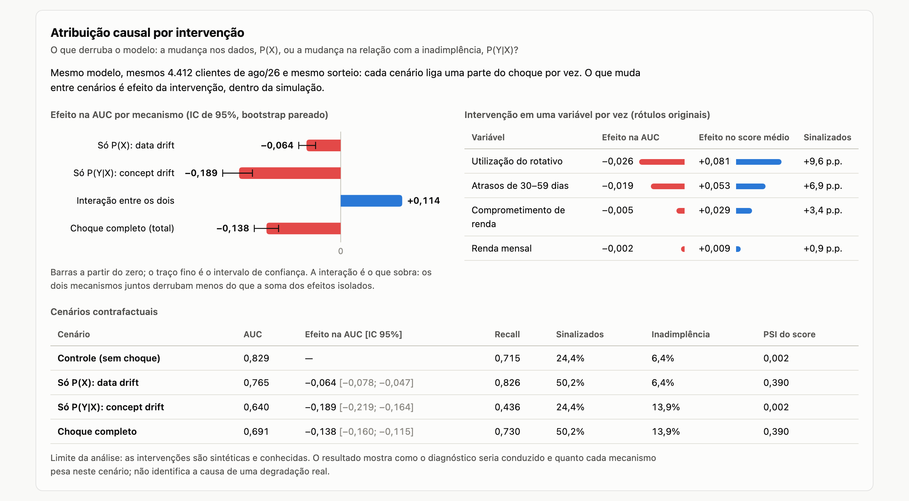

# TC04 | Drift, observabilidade e governança de um modelo de crédito

Projeto acadêmico da Fase 4 do MLET/FIAP. O cenário é uma fintech cujo modelo de Credit Scoring pode sofrer degradação silenciosa diante de mudanças econômicas e do perfil dos clientes. O objetivo é validar dados, investigar mudanças de distribuição e definir como proteger dados e responder à degradação.

Este README resume as **Etapas 1 a 3 executadas, com artefatos e evidências versionados** (contrato de dados; experimentos de data drift e de concept drift, com predições e relatórios; monitoramento por lote com observabilidade), e reúne a **proposta de governança da Etapa 4** (seções 5 a 9). O detalhe técnico de cada etapa está em [docs/](docs/). A degradação de desempenho demonstrada é sintética; não representa uma série temporal real ou evidência de causa econômica. As políticas de operação futura são distinguidas dos controles executados; não constituem evidência de conformidade integral. Os lotes de produção são **simulados**: os resultados demonstram o funcionamento do monitoramento, não o desempenho de uma operação real. O projeto não realiza concessões reais de crédito.

## 1. Resultado em resumo

- **Baseline** (XGBoost, validação fora do treino): AUC 0,857, recall 0,772 no limiar 0,5 e KS 0,568.
- **Contrato de dados**: bloqueou a entrega corrompida de maio (4.612 linhas, quatro violações) e deixou passar os dados com drift, que são válidos e apenas mudaram de distribuição.
- **Data drift nos cenários pareados** (`t1` a `t3`, mesmos 35.297 clientes e rótulos): o Evidently aponta renda, endividamento e utilização do rotativo nos três cenários, e nada no controle. O tamanho do efeito, gravado ao lado do p-valor, separa o que o teste não separa: em `t1` o KS dá p ≈ 10⁻¹²³ para a renda com PSI de 0,030; em `t3` o PSI chega a 0,600. Com duas das variáveis de maior peso no modelo alteradas (utilização do rotativo e atrasos de 30–59 dias), as decisões mudam: a parcela de clientes sinalizados vai de 24,8% para 38,5% e o PSI do score chega a 0,203, enquanto a AUC vai de 0,843 para 0,829.
- **Concept drift pareado** (`c1` a `c3`): com features e scores idênticos linha a linha, alterar o rótulo no segmento de menor renda derruba a AUC de 0,843 para 0,670 e o recall de 74,1% para 45,4% em `c3`. Nenhum monitor de entradas ou de scores vê essa mudança.
- **Lotes mensais**: em oito meses simulados com esses mesmos níveis, a AUC vai de 0,854 para 0,618. No último mês, as quatro variáveis alteradas têm PSI entre 0,117 e 0,612; as seis não alteradas ficam em no máximo 0,005 em todos os meses.
- **Degradação silenciosa**: a AUC já tinha caído 0,085 em maio, quando o maior PSI era 0,037. O primeiro sinal de PSI veio em junho, já como alerta. O teste estatístico do Evidently, mais sensível, apontava as três medidas contínuas desde abril.
- **Decomposição causal** (experimento contrafactual no último lote): a mudança na relação entre variáveis e inadimplência derruba a AUC em 0,181; a mudança só nos dados, em 0,010, mas eleva a parcela sinalizada de 24,4% para 38,1% sem que a inadimplência mude.
- **Observabilidade**: 56 eventos no log central da execução, 21 alertas (1 crítico, 13 alertas, 7 avisos), métricas por lote no MLflow e um [dashboard HTML](reports/dashboard.html) autocontido.


O GitHub não renderiza HTML: para navegar no dashboard, baixe o repositório e abra `reports/dashboard.html` no navegador.

## 2. Como os experimentos se encaixam

Os níveis de drift são definidos uma única vez, em [config.py](src/config.py), e aplicados pelas mesmas funções em todos os experimentos. O detector também é um só: o relatório do Evidently de [detect_drift.py](src/detect_drift.py), com o PSI por decis de [drift_stats.py](src/drift_stats.py) como tamanho do efeito.

| Mecanismo | Níveis | O que muda |
| --- | --- | --- |
| Data drift, P(X) | `t0_control`, `t1`, `t2`, `t3` | Renda ×0,90, ×0,75 e ×0,60; endividamento e utilização do rotativo ×1,10, ×1,30 e ×1,60; quem passa a usar todo o limite ganha um atraso de 30–59 dias. Rótulos preservados |
| Concept drift, P(Y\|X) | `c0_control`, `c1`, `c2`, `c3` | No segmento de menor renda (até o primeiro quartil da referência), bons pagadores passam a inadimplir com chance de 0,10, 0,25 e 0,50. Variáveis e scores preservados |

Três leituras desses mesmos níveis:

1. **Cenários pareados**: cada nível aplicado ao holdout inteiro, um mecanismo por vez. Medem quanto cada intensidade muda os dados e o modelo.
2. **Lotes mensais**: o holdout repartido em oito meses, com o calendário abaixo e uma entrega corrompida em maio. Alimentam o monitoramento e mostram quando cada sinal aparece.
3. **Experimento contrafactual**: no último lote, cada parte do choque ligada isoladamente. Separa o efeito de P(X) do efeito de P(Y|X).

| Mês de 2026 | jan | fev | mar | abr | mai | jun | jul | ago |
| --- | --- | --- | --- | --- | --- | --- | --- | --- |
| Data drift | `t0` | `t0` | `t0` | `t1` | `t1` | `t2` | `t2` | `t3` |
| Concept drift | `c0` | `c0` | `c0` | `c0` | `c1` | `c1` | `c2` | `c3` |

O calendário separa os dois mecanismos no tempo: abril só tem data drift fraco, e maio acrescenta concept drift sem mudar mais os dados. `t0` e `c0` são os controles.

## 3. Onde está cada coisa

| Etapa | Componente | Código | Evidência versionada | Detalhe |
| --- | --- | --- | --- | --- |
| 1 | Exploração inicial | [notebook](notebooks/01_exploracao.ipynb) | Auxiliar, sem saídas gravadas | [docs/01](docs/01-dados-e-contrato.md) |
| 1 | Limpeza e partições | [prepare.py](src/prepare.py) | [Relatório de limpeza](data/reference/cleaning_report.json) e [limites](data/reference/outlier_limits.json) | [docs/01](docs/01-dados-e-contrato.md) |
| 1 | Contrato de dados e quarentena | [contract.py](src/contract.py), [ingest.py](src/ingest.py) | [Aprovação](artifacts/stage1/20261114T201315-0300-5fbfe64d/06_ingest_good.txt), [bloqueio](artifacts/stage1/20261114T201315-0300-5fbfe64d/07_ingest_bad.txt) e [falhas](data/quarantine/bad_batch_errors.csv) | [docs/01](docs/01-dados-e-contrato.md) |
| 1 | Baseline | [train.py](src/train.py) | [Métricas](models/runs/32542e11c8c8477ea23d42db115efd0e/metrics.json) e [manifesto da execução](artifacts/stage1/20261114T201315-0300-5fbfe64d/manifest.json) | [docs/01](docs/01-dados-e-contrato.md) |
| 2 | Cenários pareados de data drift e predições | [simulate_drift.py](src/simulate_drift.py), [predict.py](src/predict.py) | Manifestos dos [cenários](data/production/scenarios/manifest.json) e das [predições](data/predictions/manifest.json) | [docs/02](docs/02-experimentos-de-drift.md) |
| 2 | Detecção com Evidently e tamanho do efeito | [detect_drift.py](src/detect_drift.py), [drift_stats.py](src/drift_stats.py) | [Resumo estatístico](reports/drift/summary.csv) e relatórios HTML em `reports/drift/` | [docs/02](docs/02-experimentos-de-drift.md) |
| 2 | Impacto dos cenários no modelo | [scenario_impact.py](src/scenario_impact.py) | [Resumo](reports/scenario_impact.json) | [docs/02](docs/02-experimentos-de-drift.md) |
| 2 | Concept drift pareado | [concept_drift.py](src/concept_drift.py) | [Análise](artifacts/concept_drift/analysis.html) e [métricas](artifacts/concept_drift/metrics.csv) | [docs/02](docs/02-experimentos-de-drift.md) |
| 2 e 3 | Lotes mensais | [simulate_batches.py](src/simulate_batches.py) | Calendário, níveis e seed no [resumo do monitoramento](reports/monitoring_summary.json) | [docs/02](docs/02-experimentos-de-drift.md) |
| 3 | Monitoramento por lote e alertas | [monitor.py](src/monitor.py), [batch_drift.py](src/batch_drift.py), [alerts.py](src/alerts.py) | [Resumo](reports/monitoring_summary.json) e relatórios do Evidently de [jan/26](reports/batches/2026-01.html) e [ago/26](reports/batches/2026-08.html) | [docs/03](docs/03-monitoramento-e-observabilidade.md) |
| 3 | Observabilidade | [observability.py](src/observability.py), [tracking.py](src/tracking.py), [dashboard.py](src/dashboard.py) | [Dashboard](reports/dashboard.html); log central e MLflow são recriados por `make report` | [docs/03](docs/03-monitoramento-e-observabilidade.md) |
| 4 | Análise causal | [causal_analysis.py](src/causal_analysis.py) | [Resultado](reports/causal_analysis.json) | Seção 7 |
| 4 | Governança | — | Seções 5 a 9 deste README | — |
| 4 | Vídeo STAR | — | Gravação e link pendentes | Seção 10 |

Documentação técnica:

- [docs/01-dados-e-contrato.md](docs/01-dados-e-contrato.md): arquitetura, preparação, contrato de dados, baseline e evidências da Etapa 1.
- [docs/02-experimentos-de-drift.md](docs/02-experimentos-de-drift.md): níveis de drift, cenários pareados, detecção com Evidently, concept drift e lotes mensais.
- [docs/03-monitoramento-e-observabilidade.md](docs/03-monitoramento-e-observabilidade.md): resultados por lote, relatórios do Evidently, log central, MLflow e dashboard.
- [docs/04-reproducao.md](docs/04-reproducao.md): ambiente, comandos, alvos do `make`, testes e ressalvas técnicas.

## 4. Como reproduzir

Com Python 3.12 e, no macOS, `brew install libomp` para o XGBoost:

```bash
python3.12 -m venv .venv
source .venv/bin/activate
python -m pip install -r requirements.txt
make all
```

`make all` roda a preparação, o treino, o impacto dos cenários, o monitoramento dos lotes mensais, a análise causal, o dashboard e os 138 testes, em cerca de um minuto e meio na máquina de desenvolvimento (macOS ARM64). As evidências dos cenários pareados e do concept drift já estão versionadas e não são refeitas por `make all`, porque os scripts que as geram recusam sobrescrever um destino existente. Os alvos individuais, a ordem para regenerar cada evidência e as ressalvas de ambiente estão em [docs/04-reproducao.md](docs/04-reproducao.md).

## 5. Plano de proteção de dados e base legal

### Dados tratados e finalidade

Os arquivos locais correspondem ao conjunto **Give Me Some Credit**, com 150.000 registros no `cs-training.csv`. A finalidade acadêmica é estimar o risco de inadimplência e estudar qualidade e confiabilidade. A origem de obtenção, a versão e os termos de uso devem ser registrados antes da entrega; a presença dos arquivos no Git não comprova autorização de redistribuição.

O alvo `SeriousDlqin2yrs` representa inadimplência grave no horizonte de dois anos. As dez variáveis preditoras são:

| Grupo | Colunas | Risco de privacidade e uso |
| --- | --- | --- |
| Perfil | `age`, `NumberOfDependents` | Combinações podem favorecer identificação e segmentação discriminatória |
| Situação financeira | `MonthlyIncome`, `DebtRatio`, `RevolvingUtilizationOfUnsecuredLines` | Informações financeiras confidenciais; possíveis proxies socioeconômicos |
| Histórico de crédito | `NumberOfTime30-59DaysPastDueNotWorse`, `NumberOfTimes90DaysLate`, `NumberOfTime60-89DaysPastDueNotWorse`, `NumberOfOpenCreditLinesAndLoans`, `NumberRealEstateLoansOrLines` | Perfil financeiro e risco de exposição de comportamento |
| Desfecho | `SeriousDlqin2yrs` | Informação de inadimplência; usada no treino e na avaliação |

Não há colunas de nome, CPF, telefone ou e-mail no arquivo de treino inspecionado. A coluna `Unnamed: 0`, um índice do arquivo, é removida na preparação. **Essa remoção não comprova anonimização**: não há avaliação de reidentificação ou técnica de anonimização implementada.

Dados financeiros e idade podem ser dados pessoais quando vinculados a pessoa identificada ou identificável; não são automaticamente dados pessoais sensíveis na definição legal. Não foram identificadas colunas explícitas de saúde, biometria, religião ou origem racial. A distinção segue o [Glossário da ANPD](https://www.gov.br/anpd/pt-br/centrais-de-conteudo/materiais-educativos-e-publicacoes/glossario-anpd).

### Finalidades e enquadramento

Na hipótese de operação real da fintech, a base legal proposta para avaliação de risco é **proteção do crédito, art. 7º, X, da LGPD**. O controlador deverá validar sua adequação à finalidade e aos dados tratados. Essa hipótese não autoriza automaticamente o reuso acadêmico ou a publicação da base. Finalidade acadêmica também exige observar os arts. 7º e 11, conforme art. 4º, II, b. Fonte: [texto atualizado da LGPD](https://www2.camara.leg.br/legin/fed/lei/2018/lei-13709-14-agosto-2018-787077-normaatualizada-pl.html).

Para este estudo, permanece pendente documentar a procedência, os termos de uso e o enquadramento do tratamento. O caráter público de uma fonte não afasta, por si só, os cuidados com dados pessoais. Fonte: [perguntas frequentes da ANPD](https://www.gov.br/anpd/pt-br/acesso-a-informacao/perguntas-frequentes).

### Privacy by Design e by Default

| Medida | Situação atual | Política proposta |
| --- | --- | --- |
| Minimização | Remoção do índice; contrato recusa colunas extras | Admitir somente atributos justificados pela finalidade; não incluir identificadores diretos nas features |
| Segregação | Diretórios de dados brutos, referência e holdout | Separar ambientes, identidades e permissões; manter chaves de associação fora da área analítica |
| Acesso | Sem controle de acesso implementado no projeto | Menor privilégio; dados detalhados restritos à equipe autorizada; revisão ao trocar integrantes |
| Armazenamento e transporte | Arquivos locais; sem configuração de criptografia no código | Armazenamento e backups criptografados; TLS nas transferências; segredos fora do Git |
| Publicação | CSV e Parquet estão versionados | Avaliar termos e risco; preferir amostras sintéticas e resultados agregados; tratar histórico Git se houver remoção necessária |
| Logs e relatórios | Log central, resumo do monitoramento, MLflow e dashboard gravam somente agregados por lote (um teste verifica que valores rejeitados não chegam ao log); o CSV de falhas da quarentena contém valores e, no monitoramento, fica fora do Git | Não registrar linhas de clientes; restringir quarentena e sanitizar valores antes de compartilhar relatórios ou vídeo |
| Descarte | Sem rotina implementada | Aplicar a tabela de retenção, incluindo cópias, backups e histórico sob controle da equipe |

O CSV de falhas pode conter valores rejeitados. Quarentena é uma área restrita de diagnóstico, não um mecanismo de anonimização. A ausência de identificadores diretos também não autoriza divulgar registros financeiros individuais.

### Direitos e decisões automatizadas

Em uma operação real, disponibilizar canal de privacidade para acesso, correção e demais solicitações aplicáveis; manter registro de atendimento. Solicitações de revisão de decisões automatizadas devem receber procedimento documentado, com informação sobre critérios e parâmetros, respeitados os segredos comercial e industrial. Fonte: [direitos dos titulares, ANPD](https://www.gov.br/anpd/pt-br/assuntos/titular-de-dados/direito-dos-titulares).

Como política do projeto para uma implantação futura, decisões contestadas ou com alerta crítico serão encaminhadas a análise humana, com justificativa registrada. O protótipo atual não possui cadastro de titulares, canal de atendimento ou sistema de decisão de crédito.

### Retenção e descarte

Os prazos abaixo são **propostas internas para o ambiente acadêmico**, contados conforme cada linha, e não prazos legais universais. Na operação real, o controlador deverá definir uma matriz própria de obrigações e necessidades antes da coleta.

| Categoria | Retenção proposta | Destino e responsável |
| --- | --- | --- |
| Dados brutos e derivados locais | Até 90 dias após a avaliação final | Engenharia de Dados elimina cópias de trabalho e confirma tratamento das cópias compartilhadas |
| Lotes em quarentena e CSVs com valores | Até 30 dias após a triagem | Engenharia de Dados corrige/reprocessa ou elimina; guarda somente resumo agregado |
| Logs sem valores individuais | 180 dias após a execução | MLOps elimina após consolidar indicadores de auditoria |
| Relatórios agregados e documentação | 12 meses após a avaliação final | Responsável pelo projeto revisa necessidade de conservação |
| Modelos e metadados | Até 12 meses após a substituição | Ciência de Dados elimina versões sem necessidade de auditoria; acesso continua restrito |

Revisar mensalmente os vencimentos; registrar categoria, data, executor e resultado do descarte. Incluir backups no ciclo de expiração. Exceções exigem motivo, aprovador e nova data de revisão. Um arquivo excluído da pasta de trabalho pode continuar no Git ou em clones: a limpeza do histórico e o alcance das cópias precisam ser avaliados separadamente. Nada disso está automatizado hoje.

## 6. Vieses e uso responsável

O dataset de treino tem 10.026 positivos em 150.000 registros, uma taxa de 6,684%. O treinamento usa `scale_pos_weight` para lidar com o desequilíbrio; isso não demonstra equidade entre grupos.

A exclusão de registros sem renda ou dependentes pode mudar a população atendida. A análise do CSV bruto, reproduzível pelo notebook auxiliar, encontra taxas de inadimplência de aproximadamente 5,61% para renda ausente e 6,95% para renda preenchida, indicando seleção potencialmente relevante. Os filtros de percentil também podem remover clientes de maior risco. Esses resultados justificam investigação, sem comprovar discriminação ou causalidade.

A simulação acrescenta um risco de uso responsável: quando só as variáveis mudam (renda menor, mais endividamento e mais uso do rotativo), o modelo passa a sinalizar 38,1% dos clientes, contra 24,4% no controle, sem que a inadimplência deles tenha mudado (seção 7). Em uma operação real isso significaria recusas indevidas concentradas em quem perdeu renda. O monitoramento implementado é agregado por lote; a avaliação por segmento descrita abaixo continua pendente.

Antes de recomendar uso operacional, a política proposta é:

1. Comparar proporções de exclusão, distribuição e inadimplência antes/depois da limpeza por faixas de idade e renda.
2. Avaliar AUC, recall, FPR, FNR e calibração por segmento, com tamanho amostral e incerteza; explicitar que o positivo representa inadimplência.
3. Comparar exclusão de renda ausente com imputação ajustada no treino e indicador de ausência, avaliando desempenho e seleção.
4. Revisar o uso de idade, dependentes e proxies socioeconômicos; justificar necessidade e alternativas.
5. Aprovar o limiar com base nos custos de inadimplência e de recusa indevida. Não converter automaticamente a probabilidade em aprovação/reprovação sem política validada.

Não há atributos explícitos suficientes para auditar todos os grupos protegidos. Sua ausência limita conclusões sobre equidade. Eventual coleta para auditoria exige finalidade, base legal e controles próprios; não deve ser feita indiscriminadamente.

## 7. Causalidade: diagnóstico e hipóteses

**Não há evidência de degradação temporal real nem de causa econômica observada.** O dataset não tem datas, e o holdout é uma amostra aleatória; o gerador de lote ruim introduz violações de contrato. O que existe são **experimentos controlados** sobre o holdout, com os níveis de drift da seção 2: os cenários pareados de `src.simulate_drift`, que alteram quatro variáveis de entrada e preservam os rótulos; o experimento de `src.concept_drift`, que altera só o rótulo de um segmento, com as features fixas; e os lotes mensais de `src.simulate_batches`, que combinam os mesmos níveis ao longo do tempo. Em todos, as diferenças de métricas podem ser atribuídas à intervenção programada, dentro do experimento. A análise a seguir mede o efeito de cada intervenção no último lote mensal. Isso mostra como o diagnóstico seria conduzido e quanto cada mecanismo pesa no cenário construído; não prova o que aconteceria com clientes reais.

### Experimento contrafactual no último lote mensal

[causal_analysis.py](src/causal_analysis.py) pega os 4.412 clientes do último lote mensal (níveis `t3` e `c3`) e aplica cada parte do choque isoladamente, com o mesmo sorteio (seed) e o mesmo modelo. Como nada mais muda entre os cenários, a diferença é o efeito da intervenção. O intervalo de confiança vem de bootstrap pareado sobre os clientes (300 reamostragens).

| Cenário | O que muda | AUC | Efeito na AUC (IC 95%) | Recall | Sinalizados | Inadimplência |
| --- | --- | ---: | --- | ---: | ---: | ---: |
| Controle | Nada | 0,829 | — | 0,715 | 24,4% | 6,4% |
| Só P(X), data drift | Variáveis no nível `t3`, rótulos originais | 0,819 | −0,010 [−0,018; +0,000] | 0,829 | 38,1% | 6,4% |
| Só P(Y\|X), concept drift | Rótulos no nível `c3`, variáveis originais | 0,648 | −0,181 [−0,211; −0,154] | 0,435 | 24,4% | 19,1% |
| Choque completo | Os dois | 0,618 | −0,211 [−0,241; −0,182] | 0,545 | 38,1% | 19,1% |



Leitura, válida dentro da simulação:

- **O concept drift é o que destrói a ordenação** (−0,181 de AUC). Ele não aparece em nenhum PSI: as variáveis e o score continuam com a distribuição do controle (PSI do score 0,002). Só o rótulo maturado o revela. O experimento pareado de concept drift chega à mesma conclusão no holdout inteiro: com features e scores idênticos, a AUC vai de 0,843 para 0,670 em `c3`.
- **O data drift sozinho quase não altera a ordenação** (−0,010 de AUC, com intervalo que encosta em zero), **mas muda as decisões**: a parcela sinalizada vai de 24,4% para 38,1% com a inadimplência inalterada, e o PSI do score chega a 0,186. O recall sobe de 0,715 para 0,829 porque o modelo sinaliza mais gente, não porque acerta melhor: a precisão cai de 18,6% para 13,9%. Os cenários pareados mostram o mesmo no holdout inteiro (24,8% para 38,5% de sinalizados em `t3`).
- **Os efeitos quase se somam**: −0,010 −0,181 daria −0,191, e o choque completo derruba −0,211. A interação, de −0,020, é pequena. Os dois mecanismos são independentes por construção: a troca de rótulo depende só da renda original do cliente e de um sorteio.
- **Por variável** (só X, uma intervenção por vez): nenhuma das quatro custa mais de 0,003 de AUC, e todos os intervalos incluem zero. O efeito aparece no score e nas decisões: utilização do rotativo, +0,056 no score médio e +8,8 pontos percentuais na parcela sinalizada; atrasos de 30–59 dias, +0,026 e +5,1; endividamento, +0,024 e +3,2; renda, +0,011 e +1,4. O modelo é mais sensível às variáveis de maior importância (utilização 0,28; atrasos de 30–59 dias 0,20). A renda tem o maior PSI do lote (0,612) e o menor efeito: a importância dela no modelo é menor que 0,02. Drift grande em uma variável não implica impacto grande na predição.

Limites: as intervenções são sintéticas e definidas por nós ([parâmetros](src/config.py)); o mecanismo real pode ser outro. Efeito medido em um cenário construído não é estimativa causal sobre dados observacionais, que exigiria dados temporais, controle de fatores de confusão e um desenho defensável.

### Hipóteses para uma degradação real

O mecanismo econômico a investigar é: mudança econômica pode afetar renda e endividamento, que podem alterar o risco de inadimplência; mudanças no público atendido e na política de aprovação também podem alterar a população observada. Essas relações são hipóteses de domínio, não conclusões obtidas neste projeto.

| Hipótese | Evidência necessária | Ação se corroborada |
| --- | --- | --- |
| Erro na coleta ou transformação | Falhas no contrato, mudança de unidade, versão da fonte e logs | Bloquear lote, corrigir origem e reprocessar |
| Data drift: mudança em P(X) | Comparação referência/análise, por exemplo em renda e endividamento, com testes e magnitude (implementada: veredito do Evidently, PSI e KS por lote, seção 8) | Investigar origem, população e impacto sobre predições |
| Concept drift: mudança em P(Y\|X) | Rótulos maturados, queda de desempenho/calibração em condições comparáveis e análise de alternativas | Avaliar recalibração ou retreinamento |
| Seleção causada pela limpeza | Comparação entre incluídos/excluídos e alternativas de tratamento | Rever filtros e repetir avaliação por segmento |
| Efeito econômico sobre inadimplência | Dados temporais, fatores de confusão e desenho causal defensável | Submeter a hipótese a análise específica antes de atribuir causa |

PSI ou um teste KS de duas amostras pode apontar mudança de distribuição; não identifica sua causa nem comprova concept drift. Queda de performance também exige investigar qualidade, seleção, mudança de política e maturação do alvo.

O experimento de data drift registra intervenções em quatro features e sua intensidade, compara cenários pareados e executa o mesmo modelo. Essa simulação usa todo o holdout sem aleatoriedade. O experimento separado de concept drift usa sorteios reproduzíveis para alterar o mecanismo do alvo. A seed 42 também se aplica à preparação e ao treinamento. Alterar apenas X mantendo rótulos antigos permite estudar sensibilidade das previsões, mas não demonstra desempenho real após uma mudança econômica; a alteração de `P(Y|X)` está explicitada no experimento de concept drift e, combinada com data drift, nos lotes mensais ([docs/02](docs/02-experimentos-de-drift.md)).

Como o alvo tem horizonte de dois anos, produção real requer política de maturação e acompanhamento de rótulos. Sem desfechos disponíveis, monitorar dados e scores e declarar a limitação de avaliação do modelo. O dataset local não permite reconstruir uma série temporal real de concessões.

## 8. Monitoramento e resposta à degradação

Esta seção separa o que está **implementado e executado sobre lotes simulados** do que continua como **política proposta**. Os limiares são pontos de partida, definidos em [config.py](src/config.py), e devem ser calibrados com dados reais; não são exigências do enunciado.

### O que é monitorado

[monitor.py](src/monitor.py) processa os lotes na ordem de chegada. Cada lote passa pelo contrato de dados (o inválido vai para a quarentena e não chega ao modelo), pela escoragem com a versão publicada, pela comparação com a referência (relatório do Evidently e tamanho do efeito por variável e para o score), pela avaliação de desempenho com o rótulo observado e pelas regras de alerta. Cada etapa grava um evento no log central, e as métricas do lote vão para o MLflow e para o dashboard. O detalhe está em [docs/03-monitoramento-e-observabilidade.md](docs/03-monitoramento-e-observabilidade.md).

Resultado nos lotes simulados (execução `mon-20261115T024544Z-cd2bd7`, modelo `32542e11…`):

| Lote | Níveis | AUC | Recall | Sinalizados | PSI máx. das variáveis | PSI do score | Alertas |
| --- | --- | ---: | ---: | ---: | ---: | ---: | --- |
| 2026-01 | `t0` e `c0` | 0,854 | 0,750 | 24,9% | 0,003 | 0,001 | — |
| 2026-02 | `t0` e `c0` | 0,847 | 0,772 | 26,0% | 0,003 | 0,002 | — |
| 2026-03 | `t0` e `c0` | 0,844 | 0,745 | 24,8% | 0,003 | 0,002 | — |
| 2026-04 | `t1` e `c0` | 0,847 | 0,775 | 28,6% | 0,035 | 0,039 | — |
| 2026-05, entrega corrompida | `t1` e `c1` | — | — | — | — | — | 1 crítico |
| 2026-05 | `t1` e `c1` | 0,773 | 0,652 | 28,9% | 0,037 | 0,040 | 2 alertas |
| 2026-06 | `t2` e `c1` | 0,763 | 0,724 | 33,9% | 0,202 | 0,113 | 2 alertas, 2 avisos |
| 2026-07 | `t2` e `c2` | 0,700 | 0,590 | 32,0% | 0,219 | 0,114 | 4 alertas, 2 avisos |
| 2026-08 | `t3` e `c3` | 0,618 | 0,545 | 38,1% | 0,612 | 0,186 | 5 alertas, 3 avisos |


**Degradação silenciosa.** Em maio a AUC caiu 0,085 (de 0,857 para 0,773) e o recall, de 0,772 para 0,652, com o maior PSI das variáveis em 0,037 e o PSI do score em 0,040: o concept drift do nível `c1` não mexe em nenhuma entrada, então nenhum monitor de variáveis ou de scores o enxerga. O alerta de AUC depende do rótulo, e no caso real a inadimplência grave leva até dois anos para maturar. Sem rótulo, o primeiro alerta pelas regras atuais seria o de PSI da renda em junho (0,202), disparado pelo data drift do nível `t2`, que é outro mecanismo. Três consequências práticas: monitorar entradas e scores não substitui o acompanhamento de rótulos maturados e de desempenho por segmento; a parcela sinalizada (28,6% em abril, contra 24,8% em março) e o PSI do score (0,039) se movem com o data drift antes de qualquer limite de PSI das variáveis e merecem acompanhamento próprio; e o teste estatístico do Evidently acusa o data drift já em abril, com efeito ainda pequeno, o que o torna candidato a aviso precoce, a calibrar pelo volume do lote.

### Regras de alerta

Implementadas em [alerts.py](src/alerts.py) e cobertas por testes. Crítico interrompe o lote; alerta exige investigação; aviso pede acompanhamento. Um alerta de drift indica mudança de distribuição, não a sua causa.

| Sinal | Critério | Severidade | Situação |
| --- | --- | --- | --- |
| Contrato de dados | Qualquer violação no lote | Crítico: bloqueia e põe em quarentena | Implementado |
| Falha operacional | Erro de leitura, de quarentena ou exceção em qualquer etapa | Crítico: interrompe o lote | Implementado |
| Volume | Lote com menos de 500 linhas | Aviso | Implementado |
| Latência | Lote levou mais de 2 vezes a mediana dos lotes anteriores da execução, com pelo menos 3 lotes anteriores | Aviso | Implementado; a proposta original usava as últimas 20 execuções válidas |
| Drift de variável | Tamanho do efeito (PSI com faixas fixas nos decis da referência) ≥ 0,10 ou ≥ 0,20 | Aviso ou alerta | Implementado. O veredito do Evidently (KS com p < 0,01 nas medidas contínuas, PSI de categorias ≥ 0,20 nas demais e sinal global em 20% das features) é registrado por lote, com o mesmo detector dos cenários pareados, e não gera alerta |
| Drift do score | O mesmo critério, sobre a probabilidade prevista | Aviso ou alerta | Implementado |
| Desempenho com rótulo | Queda absoluta de AUC ≥ 0,05 ou de recall ≥ 0,10 contra o baseline da validação, no mesmo limiar | Alerta | Implementado; são os mesmos critérios do experimento de concept drift, que compara com o controle do holdout. Na simulação o rótulo já vem pronto |
| Inadimplência observada | Taxa do lote ≥ 1,5 vez a da referência | Alerta | Implementado |
| Equidade | Aumento absoluto de FNR ou FPR ≥ 0,10 em segmento com amostra suficiente | Revisão conjunta de Ciência de Dados, Risco e Privacidade | Proposto, não implementado |

O baseline de comparação é o da versão publicada em `models/current` (hoje `models/runs/32542e11c8c8477ea23d42db115efd0e`): AUC 0,857208, recall no limiar 0,5 de 0,772268 e KS 0,567594 na validação. O volume mínimo é uma regra operacional inicial; não substitui avaliação de poder estatístico e incerteza por segmento.

### Resposta à degradação (política proposta)

Fluxo de resposta proposto:

1. Registrar incidente com horário, lote, versão do código, dados e modelo; manter amostra restrita somente se necessária.
2. Engenharia verifica integridade e pipeline; Ciência de Dados verifica distribuição, rótulos e desempenho; Risco avalia impacto nas decisões.
3. Em falha de qualidade, interromper o lote. Em degradação crítica, suspender a decisão automática ou encaminhar casos à análise humana, mediante responsável operacional.
4. Avaliar correção, recalibração ou retreinamento. Drift isolado não deve promover automaticamente um novo modelo.
5. Comparar candidato com versão vigente em dados independentes, incluindo segmentos e calibração; registrar aprovação de Risco e responsável técnico.
6. Publicar versão com monitoramento reforçado; manter versão anterior para rollback e registrar encerramento e prevenção da recorrência.

Em suspeita de exposição de dados, conter acessos, preservar evidências restritas e acionar Segurança e o encarregado. A avaliação de impacto e eventuais comunicações deve seguir a regulamentação aplicável. Não há resposta a incidentes implementada no protótipo.

O que não existe hoje: agendador, servidor de métricas, envio de alertas para e-mail, chat ou plantão, e retenção automática dos logs. Os alertas ficam no log central, no resumo, no MLflow e no dashboard, e alguém precisa abrir um deles para ver.

## 9. Responsabilidades e rastreabilidade

Os papéis abaixo deverão ser atribuídos nominalmente pelo grupo antes da entrega; não há pessoas ou contatos presumidos.

| Papel | Responsabilidade proposta |
| --- | --- |
| Responsável pelo projeto / Risco | Aprovar finalidade, política de decisão, critérios de promoção e suspensão |
| Engenharia de Dados | Contratos, qualidade, linhagem, quarentena e descarte |
| Ciência de Dados | Modelo, análise de drift, hipóteses causais e vieses |
| MLOps / Segurança | Execução, acessos, logs, versionamento, incidentes e rollback |
| Privacidade / encarregado, na operação real | Validar plano de privacidade, apoiar direitos e avaliar incidentes |

Para cada execução, a política é guardar identificador, horário, commit, ambiente e dependências, hash e origem dos dados, seed quando houver aleatoriedade, versão do contrato, exclusões, métricas, parâmetros e artefato do modelo. A execução preservada da Etapa 1 já inclui manifesto com horários, commit-base, hashes do CSV de entrada, fontes e saídas, versões das dependências, seed, comandos e códigos de saída. Inclui cópias dos scripts e testes usados, pois havia alterações locais sobre o commit-base; o manifesto não atribui esses ajustes ao commit-base. Simulação e inferência já geram manifestos próprios de entradas, saídas e parâmetros; a inferência também registra modelo e horário. Em mudanças operacionais de modelo, comparação, aprovação e motivo continuam sendo políticas propostas. Cada execução do monitoramento já registra, no resumo e no MLflow, o identificador da execução, o horário, a versão do modelo, os limiares de alerta, a seed e os parâmetros da simulação, e todos os eventos do log central carregam o mesmo identificador. Commit, hashes dos dados e ambiente ainda não são capturados automaticamente nessas execuções; a coleta completa, como a feita manualmente na Etapa 1, ainda precisa ser automatizada.

## 10. Vídeo STAR e checklist de entrega

**Link do vídeo: pendente de gravação e publicação pelo grupo.** Substituir esta indicação por um link acessível antes da entrega. Duração máxima: 5 minutos.

| Tempo | STAR | Conteúdo sugerido |
| --- | --- | --- |
| 0:00–0:40 | Situation | Cenário da fintech, risco de degradação silenciosa e impacto sobre crédito |
| 0:40–1:10 | Task | Validar dados, detectar drift, observar o pipeline e definir governança |
| 1:10–3:40 | Action | Mostrar o contrato e o bloqueio da entrega corrompida; os cenários de data drift e de concept drift e os lotes mensais; o mapa de PSI e os relatórios do Evidently; o dashboard, o log central e o MLflow; explicar privacidade e retenção |
| 3:40–5:00 | Result | AUC de 0,857 para 0,618 em oito meses simulados; a queda de maio, sem nenhum sinal nas entradas; nos cenários pareados, o data drift muda as decisões (24,8% para 38,5% de sinalizados) mais do que a ordenação; os 21 alertas; a decomposição causal; limitações (tudo é simulação), mitigação de vieses e resposta proposta |

### Antes da entrega

- [x] Documentar arquitetura e distinguir controles implementados de políticas propostas.
- [x] Explicar tratamento de dados, base legal proposta, minimização e retenção.
- [x] Documentar riscos de viés, hipóteses causais e plano de resposta.
- [ ] Registrar origem, versão, termos de uso e enquadramento dos dados acadêmicos.
- [ ] Atribuir responsáveis e validar as políticas propostas.
- [x] Executar a demonstração e guardar evidências de contrato, quarentena, modelo e métricas.
- [x] Gerar cenários sintéticos de data drift e predições com o modelo salvo.
- [x] Executar a detecção estatística e gerar os relatórios HTML de data drift da Etapa 2.
- [x] Executar experimento próprio de concept drift em `P(Y|X)` e analisar o modelo com features fixas.
- [x] Implementar a observabilidade da Etapa 3.
- [x] Atualizar a interpretação dos experimentos com resultados observados e distinguir intervenção sintética de causa econômica real.
- [ ] Revisar os dados e valores expostos no repositório, relatórios e vídeo.
- [ ] Publicar o vídeo STAR e inserir o link nesta seção.

As Etapas 1 a 3 possuem execução e evidências versionadas; a documentação de governança cobre a proposta teórica da Etapa 4. As pendências de governança marcadas acima e o vídeo ainda precisam ser concluídos pelo grupo para a entrega completa do projeto.
