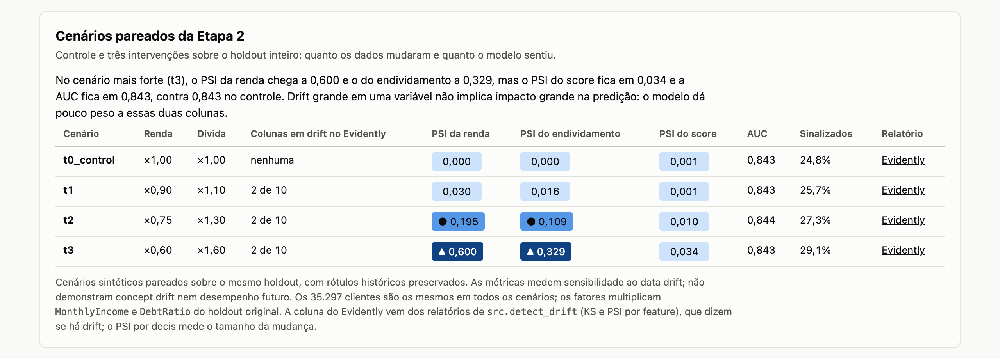

# Experimentos de drift (Etapa 2)

Parte da documentação do [TC04](../README.md). Anterior: [arquitetura, dados e contrato](01-dados-e-contrato.md). Próximo: [monitoramento e observabilidade](03-monitoramento-e-observabilidade.md).

**O dataset não fornece uma série temporal real.** Tudo nesta etapa é intervenção sintética e conhecida sobre o holdout: os resultados medem como os dados e o modelo reagem a mudanças programadas, e não o que aconteceria com clientes reais.

## Um mecanismo, três leituras

Cada mecanismo de drift é definido uma única vez e reaproveitado. Assim, o que os cenários pareados medem isoladamente é exatamente o que o monitoramento observa lote a lote.

| O que | Onde está definido | Quem usa |
| --- | --- | --- |
| Níveis de data drift (`PERIODS`) e variáveis alteradas (`DRIFT_SHIFTED_COLUMNS`) | [config.py](../src/config.py) | Cenários pareados, lotes mensais e experimento contrafactual |
| Intervenção nas variáveis (`shift_features`) | [simulate_drift.py](../src/simulate_drift.py) | Cenários pareados, lotes mensais e experimento contrafactual |
| Níveis de concept drift (`CONCEPT_PERIODS`) e quantil do corte de renda (`CONCEPT_INCOME_QUANTILE`) | [config.py](../src/config.py) | Experimento pareado de concept drift, lotes mensais e experimento contrafactual |
| Intervenção no rótulo (`shift_target`) | [concept_drift.py](../src/concept_drift.py) | Experimento pareado de concept drift, lotes mensais e experimento contrafactual |
| Calendário dos lotes (`MONTHLY_SCHEDULE`) e mês da entrega corrompida | [config.py](../src/config.py) | Lotes mensais |
| Detector de drift (`compare_datasets` e `summarize`) | [detect_drift.py](../src/detect_drift.py) | Relatórios dos cenários pareados e relatórios por lote |
| Tamanho do efeito (`psi` e `ks`) | [drift_stats.py](../src/drift_stats.py) | Resumo dos cenários, drift por lote e experimento contrafactual |

As três leituras:

1. **Cenários pareados** (`t0` a `t3` e `c0` a `c3`): cada nível aplicado ao holdout inteiro, com os mesmos clientes e um mecanismo por vez. Seções a seguir.
2. **Lotes mensais**: o holdout repartido em oito meses, cada um com um nível de cada mecanismo. Descritos no fim deste documento; os resultados estão em [monitoramento e observabilidade](03-monitoramento-e-observabilidade.md).
3. **Experimento contrafactual**: no último lote, cada parte do choque ligada isoladamente. Está na [seção 7 do README](../README.md#7-causalidade-diagnóstico-e-hipóteses), porque é a base da análise de causalidade.

## Níveis de data drift: cenários pareados

**O dataset não fornece uma série temporal real.** `t0`, `t1`, `t2` e `t3` são rótulos de cenários ordenados de um experimento, sem datas observadas, duração em meses ou alegação de evolução econômica real. Todos reutilizam os mesmos registros do holdout, na mesma ordem, para uma comparação pareada que mantém fixa a composição da amostra. Não representam safras independentes de clientes.

O script [simulate_drift.py](../src/simulate_drift.py) lê `data/production/holdout.parquet` e gera:

| Arquivo em `data/production/scenarios/` | Cenário | Fator de MonthlyIncome | Fator de DebtRatio | Fator de RevolvingUtilizationOfUnsecuredLines | Clientes com novo atraso de 30–59 dias |
| --- | --- | ---: | ---: | ---: | ---: |
| `t0_control.parquet` | Controle: cópia integral do holdout, sem alterações de valores | 1,00 | 1,00 | 1,00 | 0 |
| `t1.parquet` | Primeira intervenção sintética | 0,90 | 1,10 | 1,10 | 3.709 |
| `t2.parquet` | Segunda intervenção sintética | 0,75 | 1,30 | 1,30 | 5.510 |
| `t3.parquet` | Terceira intervenção sintética | 0,60 | 1,60 | 1,60 | 7.402 |

Cada fator é aplicado diretamente ao holdout original, sem acumular intervenções entre períodos. São parâmetros ilustrativos para reduzir renda e aumentar endividamento e uso do crédito rotativo; não são estimativas econômicas nem recalculam contabilmente `DebtRatio` a partir da renda. Valores zero permanecem zero. A regra de atraso é determinística: o cliente cuja utilização original era menor que 1 e que, multiplicada pelo fator do período, chega a 1 ou mais (passa a usar todo o limite) recebe mais um atraso de 30–59 dias. Todas as demais features e o alvo histórico `SeriousDlqin2yrs` são preservados. Manter esses rótulos após alterar as features permite estudar sensibilidade, mas não comprova concept drift nem desempenho futuro real.

A utilização do rotativo e os atrasos de 30–59 dias fazem parte dos cenários porque estão entre as variáveis de maior peso no modelo (importâncias do XGBoost de 0,28 e 0,20, primeira e terceira entre dez). Renda e endividamento são a nona e a sexta (0,018 e 0,026): com apenas essas duas alteradas, o drift seria grande e o modelo quase não reagiria.

O controle não recebe intervenção; isso não garante ausência de diferenças estatísticas em relação ao treino. O holdout já passou pela limpeza da Etapa 1. Não há nova filtragem por p99 após as intervenções, para não remover a mudança introduzida. O script valida a entrada e todos os cenários com o contrato Pandera antes de publicar os arquivos. A referência de treino, a validação, o holdout e o modelo permanecem intactos; não há treinamento nessa operação.

O `manifest.json` registra o caminho e o hash SHA-256 da entrada, os fatores, a regra de atraso, o número de registros, quantos clientes receberam o novo atraso, os hashes dos arquivos gerados e as limitações do experimento. O processo usa todo o holdout e não contém amostragem ou aleatoriedade; não requer seed. Metadados ficam no manifesto, fora dos Parquet, para preservar o contrato estrito.

Na execução versionada, cada cenário contém 35.297 registros e passa pelo contrato. O [manifesto gerado](../data/production/scenarios/manifest.json) registra os artefatos. Conferido após a geração: o controle coincide integralmente com o holdout após a leitura dos Parquet; nos demais cenários só as quatro colunas alteradas diferem do holdout; os hashes dos arquivos conferem com o manifesto; e a referência, a validação, o holdout e o modelo publicado não foram alterados.

Para gerar os cenários usando o holdout existente:

```bash
make simulate-drift PYTHON=.venv/bin/python
```

O alvo não depende de `prepare`, evitando regenerar a referência. Para outra entrada ou destino:

```bash
.venv/bin/python -m src.simulate_drift --holdout data/production/holdout.parquet --output-dir /tmp/tc04-scenarios
```

O destino deve ser inexistente; reexecuções não sobrescrevem cenários anteriores. Os quatro Parquet e o manifesto são publicados juntos após a gravação em diretório temporário. A inferência e a detecção estatística com Evidently estão descritas a seguir.

## Predições na referência e nos cenários

O script [predict.py](../src/predict.py) carrega `models/current/model.joblib` uma única vez, resolvendo o apontador para a versão publicada, e executa o mesmo modelo na referência e em `t0_control`, `t1`, `t2` e `t3`. Não executa preparação ou treinamento e não altera os arquivos de entrada. Cada dataset é validado com Pandera. As entradas do modelo são selecionadas exclusivamente com `df.loc[:, FEATURE_COLUMNS]`, na ordem do contrato e sem o alvo; essa ordem também é conferida contra os nomes de features do modelo salvo.

```bash
make predict PYTHON=.venv/bin/python
```

Os resultados ficam em `data/predictions/{reference,t0_control,t1,t2,t3}.parquet`. Cada arquivo contém:

| Coluna | Significado |
| --- | --- |
| `row_position` | Posição da linha no Parquet de origem, começando em zero; nenhuma linha é removida ou reordenada |
| `SeriousDlqin2yrs` | Alvo histórico, copiado para permitir análises posteriores; não é entrada do modelo |
| `probability_0` | Probabilidade estimada para a classe 0 |
| `probability_1` | Probabilidade estimada para a classe 1 (inadimplência grave) |
| `predicted_class` | 1 quando `probability_1 >= 0.5`, e 0 caso contrário, seguindo o limiar da avaliação do baseline |

O `manifest.json` de predições registra a versão resolvida e o hash SHA-256 do modelo, horário UTC, ordem de features, regra de classificação, caminhos/hashes das entradas e hashes/quantidades das saídas. Para associar resultados às features, usar a posição das linhas no arquivo de origem indicado no manifesto e conferir seu hash. As predições ficam separadas dos dados para preservar o contrato estrito. O conjunto completo é publicado após concluir todos os arquivos; destino existente causa erro, preservando resultados anteriores.

Para outro destino ou uma versão explícita de modelo:

```bash
.venv/bin/python -m src.predict --model models/runs/32542e11c8c8477ea23d42db115efd0e/model.joblib --output-dir /tmp/tc04-predictions
```

Os argumentos `--reference` e `--scenarios-dir` também permitem indicar outras entradas. As predições na referência são sobre dados usados no treinamento, sem representar avaliação independente. Nos períodos sintéticos, os rótulos históricos permanecem inalterados; resultados não comprovam concept drift nem desempenho futuro real.

Na execução local com o modelo `32542e11c8c8477ea23d42db115efd0e`, foram salvas 65.867 predições na referência e 35.297 em cada cenário, totalizando 207.055. O [manifesto de inferência](../data/predictions/manifest.json) registra a procedência. Após recarregar os cinco Parquet, probabilidades e classes coincidiram exatamente com uma nova inferência do modelo salvo; posições e rótulos também coincidiram com as entradas. Os hashes de entrada e de saída gravados no manifesto conferem com os arquivos.

## Detecção com Evidently AI e tamanho do efeito

O script [detect_drift.py](../src/detect_drift.py) integra o Evidently **0.7.23** usando a API `Dataset`, `DataDefinition`, `Report` e `DataDriftPreset`, conforme a [documentação oficial de relatórios](https://docs.evidentlyai.com/docs/library/report) e de [métodos de drift](https://docs.evidentlyai.com/metrics/customize_data_drift). A execução é local, com telemetria de uso desabilitada por `DO_NOT_TRACK=1`. Não requer conta, servidor ou envio dos dados à plataforma Evidently.

```bash
make detect-drift PYTHON=.venv/bin/python
```

Cada cenário é comparado com `data/reference/reference.parquet`. Entrada e referência passam pelo contrato Pandera; somente `FEATURE_COLUMNS` são entregues ao Evidently. O alvo, `row_position`, probabilidades e classes previstas não participam dessa comparação. Os arquivos de inferência continuam disponíveis para análises posteriores de scores e desempenho, separadas da detecção de data drift.

Os métodos e limiares são explícitos em `src/config.py`, sem depender da seleção automática por cardinalidade do Evidently:

| Grupo | Features | Método | Critério por feature |
| --- | --- | --- | --- |
| Medidas financeiras contínuas | `MonthlyIncome`, `DebtRatio`, `RevolvingUtilizationOfUnsecuredLines` | KS de duas amostras | p-valor < 0,01 |
| Idade e contagens, tratadas como categorias | As outras sete features do contrato | PSI sobre frequências das categorias | PSI ≥ 0,20 |

O PSI categórico usa a união dos valores presentes nas duas amostras e o tratamento de frequências zero do Evidently 0.7.23; não discretiza renda ou dívida. O KS evita a escolha de bins para as medidas financeiras. O p-valor não mede a magnitude nem o impacto de negócio, e os testes podem ser sensíveis ao volume e a valores repetidos. Os limiares são escolhas iniciais do experimento, sem correção de múltiplas comparações; não são exigências do enunciado nem critérios universais. O critério global sinaliza drift quando **pelo menos 20% das dez features** apresentam drift; os resultados individuais continuam disponíveis mesmo abaixo desse percentual.

**Tamanho do efeito.** Com 35 mil linhas, o KS acusa mudanças muito pequenas. Para que o resumo diga também de que tamanho é a mudança, `summary.csv` traz três colunas além do veredito: `effect_psi`, o PSI com faixas fixas nos decis da referência ([drift_stats.py](../src/drift_stats.py)); `effect_level`, a leitura usual desse índice (`pequeno` abaixo de 0,10, `moderado` de 0,10 a 0,20 e `grande` a partir de 0,20); e `ks_statistic`, a maior distância entre as distribuições acumuladas. O PSI por decis é prática usual em risco de crédito. O PSI numérico nativo do Evidently usa faixas de largura igual; em variáveis de cauda longa, como renda e endividamento, quase toda a massa cai na primeira faixa e o índice fica insensível. Em contagens com até 20 valores distintos, cada valor é uma faixa. Limitação de qualquer PSI por faixas: mudanças dentro de uma mesma faixa, ou valores acima do máximo da referência que caem na última faixa, não alteram o índice. O tamanho do efeito não entra no veredito: `drift_detected` continua sendo o do Evidently.

O diretório `reports/drift/` contém quatro relatórios HTML, quatro JSONs nativos do Evidently, `summary.csv` com as 40 comparações por feature e cenário e `manifest.json` com versões das bibliotecas, parâmetros, hashes das entradas/saídas, maior efeito de cada cenário e limitações. Nos relatórios, testes em falha indicam drift detectado, não falha operacional do script. Uma execução concluída retorna 0 mesmo com drift; erros de leitura, contrato ou geração propagam erro e não publicam um conjunto parcial. O destino deve ser inexistente. Para outro conjunto ou destino:

```bash
.venv/bin/python -m src.detect_drift --reference data/reference/reference.parquet --scenarios-dir data/production/scenarios --output-dir /tmp/tc04-drift
```

Resultados da execução versionada:

| Cenário | Features com drift | Proporção | Maior tamanho de efeito | Relatório |
| --- | --- | ---: | --- | --- |
| Controle | Nenhuma | 0/10 | 0,001 em `NumberOfDependents` (pequeno) | [t0_control.html](../reports/drift/t0_control.html) |
| t1 | `MonthlyIncome`, `DebtRatio`, `RevolvingUtilizationOfUnsecuredLines` | 3/10 | 0,036 em `NumberOfTime30-59DaysPastDueNotWorse` (pequeno) | [t1.html](../reports/drift/t1.html) |
| t2 | `MonthlyIncome`, `DebtRatio`, `RevolvingUtilizationOfUnsecuredLines` | 3/10 | 0,195 em `MonthlyIncome` (moderado) | [t2.html](../reports/drift/t2.html) |
| t3 | `MonthlyIncome`, `DebtRatio`, `RevolvingUtilizationOfUnsecuredLines` | 3/10 | 0,600 em `MonthlyIncome` (grande) | [t3.html](../reports/drift/t3.html) |

Tamanho do efeito nas quatro variáveis alteradas:

| Variável alterada | Método do Evidently | Veredito | Efeito em `t1` | Efeito em `t2` | Efeito em `t3` |
| --- | --- | --- | --- | --- | --- |
| `MonthlyIncome` | KS, p < 0,01 | drift em `t1`, `t2` e `t3` | 0,030 (pequeno) | 0,195 (moderado) | 0,600 (grande) |
| `DebtRatio` | KS, p < 0,01 | drift em `t1`, `t2` e `t3` | 0,016 (pequeno) | 0,109 (moderado) | 0,329 (grande) |
| `RevolvingUtilizationOfUnsecuredLines` | KS, p < 0,01 | drift em `t1`, `t2` e `t3` | 0,015 (pequeno) | 0,061 (pequeno) | 0,144 (moderado) |
| `NumberOfTime30-59DaysPastDueNotWorse` | PSI de categorias ≥ 0,20 | sem drift | 0,036 (pequeno) | 0,071 (pequeno) | 0,124 (moderado) |

No controle, os p-valores de renda, dívida e utilização foram aproximadamente 0,925, 0,588 e 0,603. Em `t1`, aproximadamente 1,01 × 10⁻¹²³, 1,91 × 10⁻⁶⁰ e 3,23 × 10⁻²²⁷, com tamanhos de efeito de 0,030, 0,016 e 0,015: o teste dá o mesmo veredito para `t1` e para `t3`, e é o tamanho do efeito que os distingue. Em `t2` e `t3`, a biblioteca retornou 0 por precisão numérica para esses p-valores extremamente pequenos. As seis features não alteradas têm tamanho de efeito de no máximo 0,001 em todos os cenários. Os números completos estão no [resumo estatístico](../reports/drift/summary.csv) e a procedência no [manifesto](../reports/drift/manifest.json).

A ausência de drift no controle é um resultado observado, sem garantia para outras amostras. A detecção em renda, dívida e utilização confirma mudanças de distribuição introduzidas no experimento; não comprova queda de desempenho, causa econômica ou concept drift. Os atrasos de 30–59 dias mudam (7.402 clientes em `t3`), mas o PSI de categorias do Evidently fica em 0,037, 0,072 e 0,125, abaixo do limiar de 0,20: uma variável importante pode mudar sem ser sinalizada por feature, e por isso o monitoramento acompanha também o score. O efeito dessas mudanças no modelo está na próxima seção; o experimento que altera explicitamente `P(Y|X)` vem depois.

## Impacto dos cenários no modelo

[scenario_impact.py](../src/scenario_impact.py) junta as duas evidências já publicadas, sem recalcular nenhuma: lê o tamanho do efeito de `reports/drift/summary.csv` e as probabilidades de `data/predictions/`, e mede o que muda nas decisões (PSI do score, métricas com os rótulos preservados e parcela sinalizada no limiar 0,5). O resultado fica no [resumo](../reports/scenario_impact.json). Se uma das duas evidências faltar, o script falha em vez de recalcular.

| Cenário | Features com drift no Evidently | PSI da renda | PSI do endividamento | PSI da utilização | PSI dos atrasos de 30–59 dias | PSI do score | AUC | Recall | Precisão | Sinalizados |
| --- | --- | --- | --- | --- | --- | --- | ---: | ---: | ---: | ---: |
| `t0_control` | nenhuma | 0,000 | 0,000 | 0,000 | 0,000 | 0,001 | 0,843 | 0,741 | 19,7% | 24,8% |
| `t1` | 3 de 10 | 0,030 | 0,016 | 0,015 | 0,036 | 0,042 | 0,835 | 0,776 | 17,8% | 28,8% |
| `t2` | 3 de 10 | 0,195 (aviso) | 0,109 (aviso) | 0,061 | 0,071 | 0,103 (aviso) | 0,833 | 0,815 | 16,1% | 33,4% |
| `t3` | 3 de 10 | 0,600 (alerta) | 0,329 (alerta) | 0,144 (aviso) | 0,124 (aviso) | 0,203 (alerta) | 0,829 | 0,842 | 14,5% | 38,5% |

O Evidently aponta as mesmas três colunas nos três cenários; o tamanho do efeito mostra que eles não são equivalentes: tudo fica abaixo de 0,10 em `t1`, renda e endividamento geram aviso em `t2`, e em `t3` as quatro variáveis passam de 0,10. As demais variáveis ficam em no máximo 0,001. A capacidade de ordenar cai pouco (AUC de 0,843 para 0,829). O que muda é a decisão no limiar fixo de 0,5: a parcela sinalizada passa de 24,8% para 38,5% com a mesma inadimplência (6,6%), o recall sobe de 0,741 para 0,842 e a precisão cai de 19,7% para 14,5%. Em uma operação real, isso seria mais gente recusada sem que o risco observado tivesse mudado. Como os rótulos são os históricos, esses cenários não dizem nada sobre concept drift.



## Níveis de concept drift: experimento pareado

[concept_drift.py](../src/concept_drift.py) mantém **as mesmas features, os mesmos clientes, a mesma ordem, o mesmo modelo e o limiar 0,5** em quatro cenários. Altera somente o mecanismo do alvo histórico. A distinção entre mudanças em `P(X)` e em `P(Y|X)` segue a formulação de [Tan, Lee e Salehi (2019)](https://arxiv.org/abs/1909.11251); aqui a mudança condicional é conhecida por construção, não inferida somente pela mudança da prevalência.

O segmento afetado é `MonthlyIncome ≤ 3500`, corte ajustado no primeiro quartil **somente da referência de treino**. Inclui 9.147 registros do holdout (aproximadamente 25,9%; os empates no corte explicam a diferença para 25%). A hipótese ilustrativa é um choque adicional de inadimplência nesse segmento. Não há estimativa de inflação, desemprego ou efeito causal econômico.

Para cada linha, sortear `U ~ Uniforme(0,1)`, independente do modelo, com seed 42 e reutilizar o mesmo `U` nos quatro cenários. Com `S(X)` indicando o segmento e `Y0` o rótulo histórico:

```text
Yq = Y0 OU (S(X) E U < q)
Pq(Y=1|X) = p0(X) + (1 - p0(X)) * q * S(X)
```

`p0(X)` é a probabilidade histórica desconhecida, não o score do modelo. Apenas rótulos 0 no segmento podem virar 1; positivos históricos e rótulos fora do segmento permanecem intactos. Os valores de `q` são 0, 0,10, 0,25 e 0,50, definidos em `src/config.py`. São chances adicionais para os negativos elegíveis, não taxas finais de inadimplência. O uso dos mesmos sorteios torna as alterações cumulativas entre cenários. O mecanismo não usa scores nem ajusta parâmetros para obter determinada queda de métrica. A função que aplica essa regra, `shift_target`, é a mesma usada nos lotes mensais.

```bash
make concept-drift PYTHON=.venv/bin/python
```

O comando usa o holdout original, não os cenários de data drift, e publica um conjunto completo em `artifacts/concept_drift/`: datasets, predições, auditoria por linha em `interventions.parquet`, métricas globais e por segmento, sensibilidade a cinco seeds, quatro relatórios de classificação HTML/JSON do Evidently, comparação de features e manifesto com parâmetros, versões e hashes. Os [relatórios de classificação](https://docs.evidentlyai.com/metrics/preset_classification) usam o controle do mesmo holdout como referência, com gráficos ROC/PR e matrizes de confusão; a validação do treino não é usada como baseline desse experimento. Não há treinamento, recalibração ou mudança de limiar.

Resultados com seed 42, todos com 35.297 registros:

| Cenário | q | Rótulos alterados | Prevalência | AUC ROC | Recall | Precisão | Falsos negativos |
| --- | ---: | ---: | ---: | ---: | ---: | ---: | ---: |
| c0_control | 0 | 0 | 6,62% | 0,843257 | 74,09% | 19,74% | 605 |
| c1 | 0,10 | 815 | 8,92% | 0,768076 | 62,22% | 22,37% | 1.190 |
| c2 | 0,25 | 2.062 | 12,46% | 0,710069 | 52,49% | 26,34% | 2.089 |
| c3 | 0,50 | 4.123 | 18,30% | 0,669626 | 45,35% | 33,42% | 3.529 |

**Comportamento observado:** a probabilidade média prevista permanece 0,326790 e a proporção de classes positivas previstas permanece 24,83% em todos os cenários. As probabilidades e classes são idênticas linha a linha; o modelo não tem sinal de entrada que revele o choque. Mesmo assim, em c3 a AUC cai 0,173631 e o recall cai 28,74 pontos percentuais. O Brier piora de 0,147595 para 0,182354 e o log loss de 0,459707 para 0,553312. O KS de classificação cai de 0,533130 para 0,258752. As três intensidades ativam os critérios experimentais de queda absoluta de AUC ≥ 0,05 ou recall ≥ 0,10 em relação ao controle.

A precisão aumenta porque, dentro da mesma lista de previsões positivas, passam a existir mais positivos nos novos rótulos. O F1 também aumenta e a average precision de c3 fica próxima à do controle; essas métricas respondem à prevalência e não demonstram recuperação da discriminação. A ponderação de classes do baseline não garante probabilidades calibradas. Os resultados completos estão em [metrics.csv](../artifacts/concept_drift/metrics.csv).

No segmento afetado, a AUC cai de 0,841789 para 0,548125 e o recall de 81,58% para 37,49%; a prevalência sobe de 8,60% para 53,68%. Fora dele, rótulos e todas as métricas permanecem iguais. Isso localiza o efeito na intervenção programada, sem transformá-la em evidência de vulnerabilidade real de um grupo. Ver [métricas por segmento](../artifacts/concept_drift/segment_metrics.csv).

A sensibilidade usa as seeds 42–46 com os mesmos parâmetros e modelo. Em c3, a AUC varia de 0,669626 a 0,673019 e o recall de 44,75% a 45,84%, mantendo a degradação nas cinco realizações. Esses mínimos/máximos **não são intervalos de confiança** e não validam a hipótese econômica. Ver [sensitivity.csv](../artifacts/concept_drift/sensitivity.csv).

A igualdade exata das features é verificada em todos os períodos. A [comparação Evidently entre c3 e o controle](../artifacts/concept_drift/feature_drift.html) confirma zero features com drift. Monitorar apenas distribuições de entrada e scores não detectaria esse experimento: é necessário acompanhar rótulos maturados, desempenho e erros por segmento. A [análise consolidada](../artifacts/concept_drift/analysis.html) reúne interpretação e links; o [manifesto](../artifacts/concept_drift/manifest.json) registra a procedência. Os dados, modelo e relatórios anteriores permanecem intactos.

Para outra execução, escolher destino inexistente:

```bash
.venv/bin/python -m src.concept_drift --seed 43 --output-dir /tmp/tc04-concept-drift
```

Os argumentos `--reference`, `--holdout` e `--model` permitem indicar versões explícitas das entradas. Uma falha não publica resultados parciais; um destino existente é preservado. O experimento é um teste de estresse sintético, sem uma série temporal real e sem comprovar degradação do modelo em concessões reais. Em produção, o alvo de dois anos exige política de maturação. Antes de qualquer atualização operacional, investigar origem dos rótulos e comparar candidatos em dados independentes; nenhum modelo novo é promovido aqui.

Reexecutado em diretório temporário depois da unificação dos módulos, o experimento reproduziu exatamente as métricas, os datasets e as predições versionados em `artifacts/concept_drift/`.

## Lotes mensais

O dataset não tem datas. Para representar a passagem do tempo, [simulate_batches.py](../src/simulate_batches.py) embaralha o holdout (35.297 clientes que o modelo nunca viu) e o reparte em 8 lotes mensais de cerca de 4.412 linhas, de 2026-01 a 2026-08. Cada lote recebe um nível de data drift e um de concept drift, conforme o calendário `MONTHLY_SCHEDULE` de [config.py](../src/config.py), aplicados pelas mesmas funções dos experimentos pareados (`shift_features` e `shift_target`). A referência é sempre a partição de treino (`data/reference/`), separada da produção (`data/production/`).

| Lote | Data drift | Concept drift | O que o mês acrescenta |
| --- | --- | --- | --- |
| 2026-01 a 2026-03 | `t0_control` | `c0_control` | Período de controle: os dados como chegaram |
| 2026-04 | `t1` | `c0_control` | Data drift fraco, com os rótulos intactos |
| 2026-05 | `t1` | `c1` | Concept drift começa, sem mudar mais os dados; antes chega a entrega corrompida |
| 2026-06 | `t2` | `c1` | Data drift moderado |
| 2026-07 | `t2` | `c2` | Concept drift mais forte |
| 2026-08 | `t3` | `c3` | Os dois mecanismos no nível máximo |

O segmento do concept drift é definido pela renda original do cliente (até 3.500, o primeiro quartil da referência), antes do fator de renda do mês, e o sorteio de cada mês usa a seed 42 somada à posição do mês. Tudo é determinístico: o calendário, os níveis, o corte de renda e a seed ficam gravados no manifesto dos lotes e no [resumo do monitoramento](../reports/monitoring_summary.json). Em 2026-05 chega antes uma **entrega corrompida** do mesmo mês: 120 rendas nulas, 40 idades iguais a zero, 20 razões de dívida negativas e 200 linhas reenviadas em duplicidade.

Os lotes ficam fora do Git, em `data/production/batches/`, e são recriados por `make simulate-batches` ou `make monitor`. O resultado do monitoramento está em [monitoramento e observabilidade](03-monitoramento-e-observabilidade.md).
