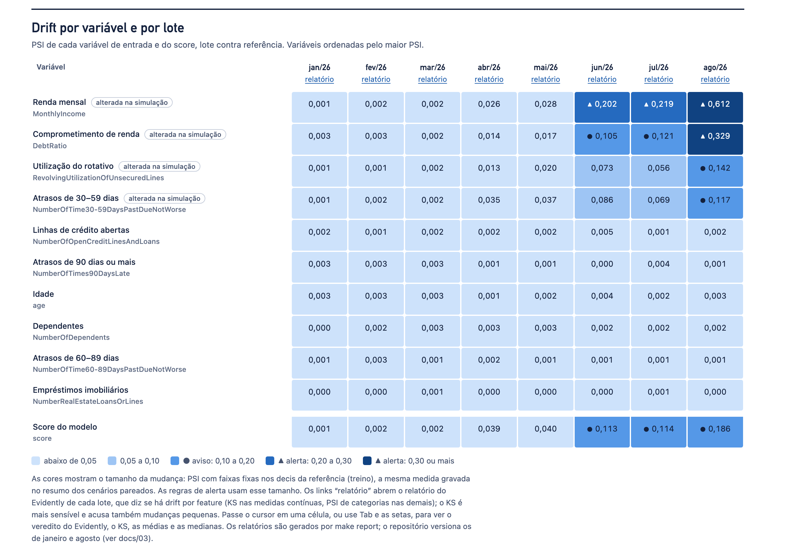
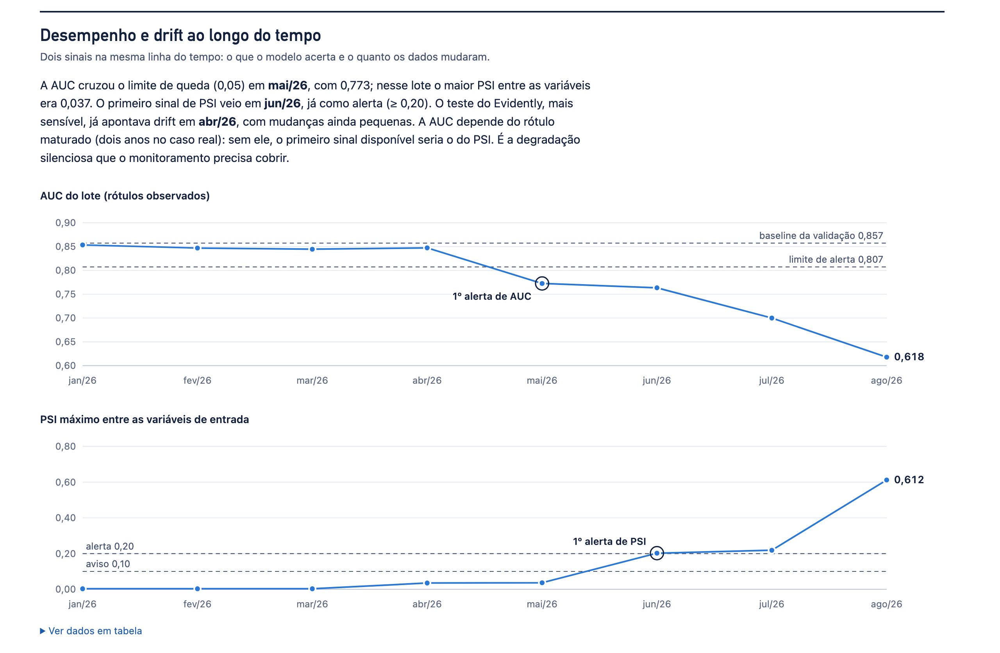
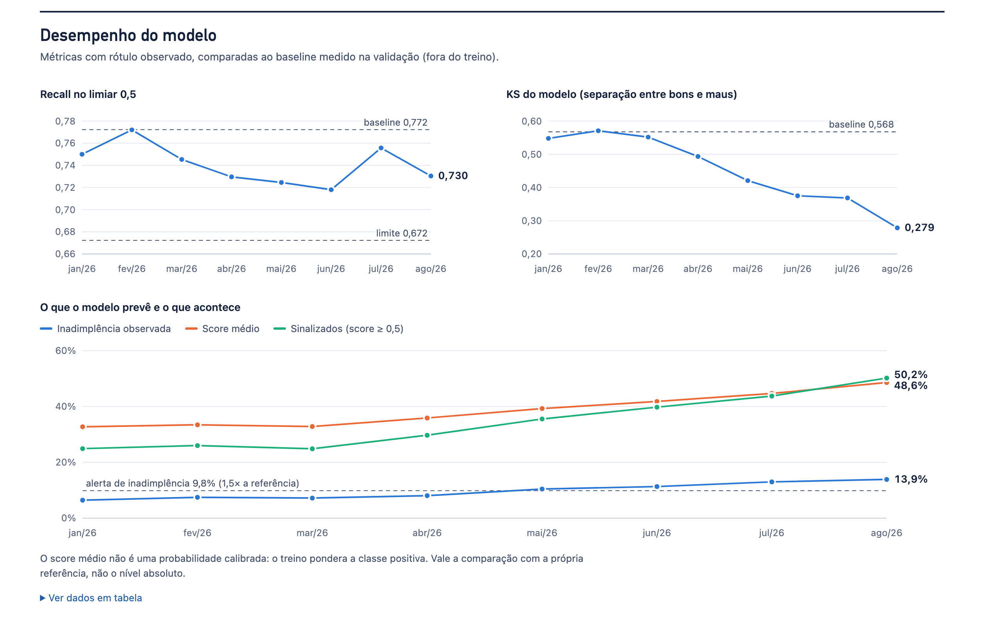
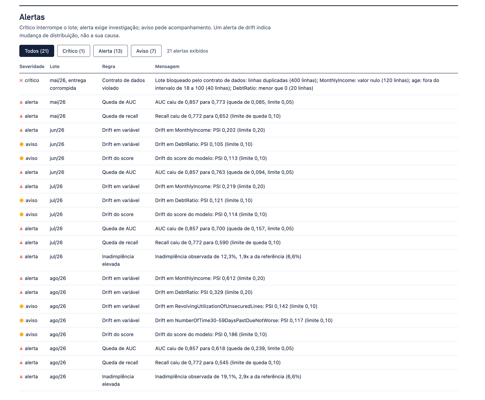
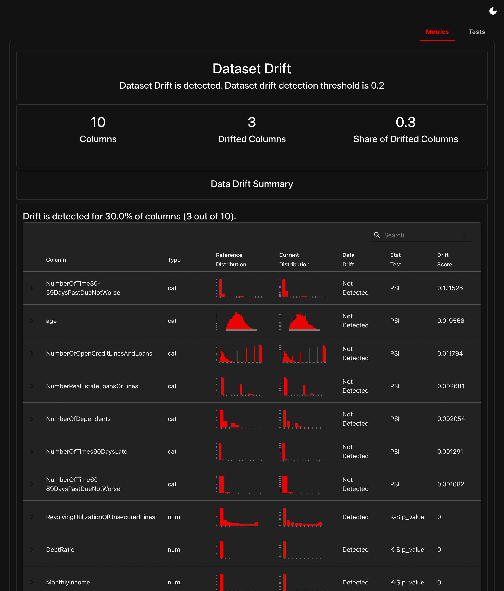
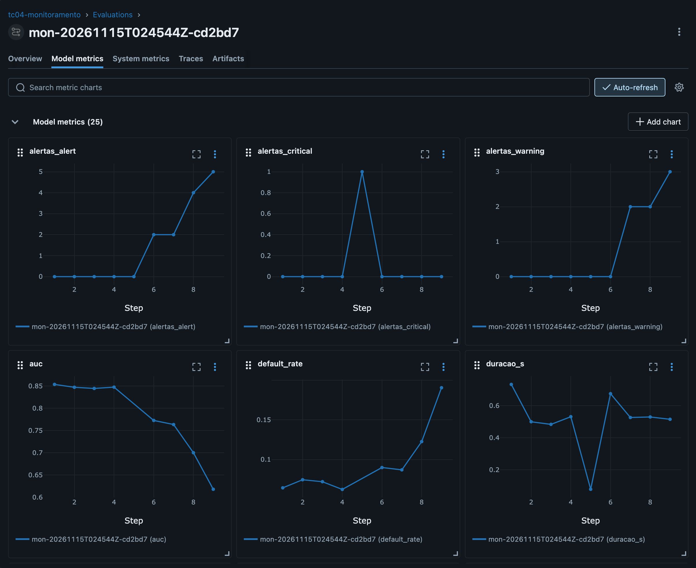
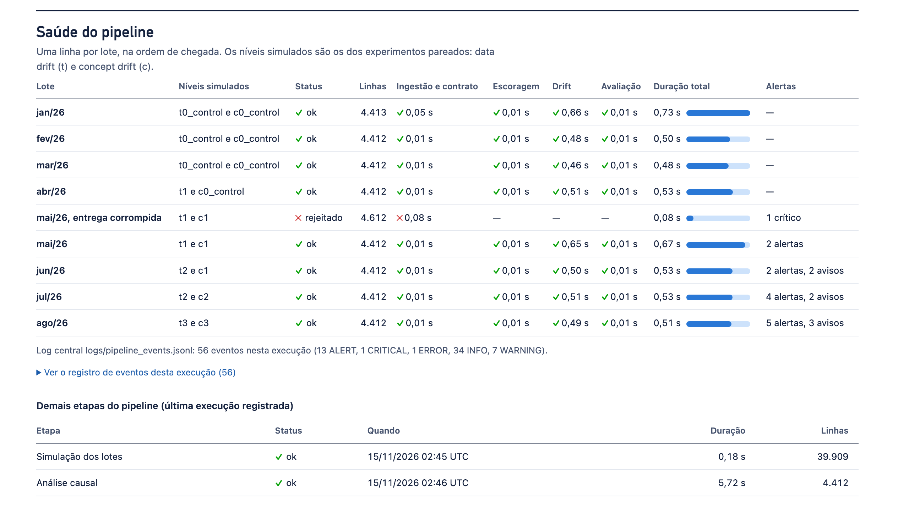

# Monitoramento por lote e observabilidade (Etapa 3)

Parte da documentação do [TC04](../README.md). Anterior: [experimentos de drift](02-experimentos-de-drift.md). Próximo: [reprodução](04-reproducao.md).

Os lotes são simulados ([lotes mensais](02-experimentos-de-drift.md#lotes-mensais)): os resultados demonstram o funcionamento do monitoramento, não o desempenho de uma operação real. As regras de alerta e a política de resposta estão na [seção 8 do README](../README.md#8-monitoramento-e-resposta-à-degradação).

## O que roda em cada lote

[monitor.py](../src/monitor.py) processa os lotes na ordem de chegada. Para cada um:

1. **Contrato** ([ingest.py](../src/ingest.py)): o lote inválido vai para `data/quarantine/<execução>/` e é interrompido antes de chegar ao modelo.
2. **Escoragem** com a versão publicada em `models/current`.
3. **Drift** ([batch_drift.py](../src/batch_drift.py)): relatório do Evidently e tamanho do efeito por variável e para o score.
4. **Desempenho** com o rótulo observado: AUC, recall e precisão no limiar 0,5, KS, inadimplência, score médio e parcela sinalizada.
5. **Regras de alerta** ([alerts.py](../src/alerts.py)).

Cada etapa grava um evento no log central, e as métricas do lote vão para o MLflow.

## Drift por lote

Para cada lote aprovado, [batch_drift.py](../src/batch_drift.py) compara a referência com o lote usando **o mesmo detector dos cenários pareados** (`compare_datasets`, de [detect_drift.py](../src/detect_drift.py)): KS com p < 0,01 nas três medidas contínuas, PSI de categorias ≥ 0,20 nas outras sete features e sinal global quando 20% das features têm drift. O relatório HTML do Evidently de cada lote vai para `reports/batches/`, e o veredito por feature fica no resumo do monitoramento (`evidently_drift`).

O veredito responde **se** há drift. Para as regras de alerta a pergunta é de **tamanho**, e o resumo traz, para cada uma das 10 variáveis e para o score do modelo:

- **PSI por decis da referência** ([drift_stats.py](../src/drift_stats.py)), o mesmo tamanho de efeito gravado no `summary.csv` dos cenários. É o índice das regras de alerta: aviso a partir de 0,10 e alerta a partir de 0,20.
- **Teste KS** de duas amostras (estatística e p-valor), como evidência complementar.
- Média e mediana na referência e no lote.

O score não entra no relatório do Evidently, que recebe só as features do contrato; o drift do score é medido pelo PSI por decis e pelo KS. O alvo também ficou fora, de propósito: PSI em variável binária é pouco sensível (dobrar a inadimplência dá cerca de 0,05), então a regra para o alvo compara a taxa observada com a da referência.

O veredito do Evidently não gera alerta no monitoramento, mas o resultado dele merece registro. Apontou renda, endividamento e utilização do rotativo já em **abril**, quando o maior PSI era 0,035, e manteve as três até agosto. Não apontou nenhuma das seis variáveis não alteradas, nem nada nos meses de controle. O KS calculado para todas as colunas (p < 0,01) acusou também os atrasos de 30–59 dias e o score desde abril, e nenhuma das seis variáveis não alteradas em 48 testes (o menor p-valor entre elas foi 0,028). O teste é mais sensível que o PSI. O custo aparece nos cenários pareados: com 35 mil linhas, o KS dá p ≈ 10⁻¹²³ para a renda em `t1`, onde o PSI é 0,030. Significância não é magnitude. Por isso a regra de alerta usa o tamanho do efeito, e o teste fica como candidato a aviso precoce, a calibrar pelo volume do lote.

## Resultados dos lotes mensais

Execução `mon-20261115T024544Z-cd2bd7`, com o modelo `32542e11…`. Baseline da validação: AUC 0,857, recall 0,772 e KS 0,568. Na referência, a inadimplência é de 6,6% e o modelo sinaliza 24,6% dos clientes.

| Lote | Níveis | Status | AUC | Recall | KS | Inadimplência | Sinalizados | PSI máx. das variáveis | PSI do score | Features com drift no Evidently | Alertas |
| --- | --- | --- | ---: | ---: | ---: | ---: | ---: | ---: | ---: | --- | --- |
| 2026-01 | `t0` e `c0` | ok | 0,854 | 0,750 | 0,548 | 6,4% | 24,9% | 0,003 | 0,001 | nenhuma | — |
| 2026-02 | `t0` e `c0` | ok | 0,847 | 0,772 | 0,571 | 7,5% | 26,0% | 0,003 | 0,002 | nenhuma | — |
| 2026-03 | `t0` e `c0` | ok | 0,844 | 0,745 | 0,552 | 7,2% | 24,8% | 0,003 | 0,002 | nenhuma | — |
| 2026-04 | `t1` e `c0` | ok | 0,847 | 0,775 | 0,538 | 6,2% | 28,6% | 0,035 | 0,039 | 3 de 10 | — |
| 2026-05, entrega corrompida | `t1` e `c1` | **rejeitado** | — | — | — | — | — | — | — | — | 1 crítico |
| 2026-05 | `t1` e `c1` | ok | 0,773 | 0,652 | 0,411 | 9,0% | 28,9% | 0,037 | 0,040 | 3 de 10 | 2 alertas |
| 2026-06 | `t2` e `c1` | ok | 0,763 | 0,724 | 0,429 | 8,7% | 33,9% | 0,202 | 0,113 | 3 de 10 | 2 alertas, 2 avisos |
| 2026-07 | `t2` e `c2` | ok | 0,700 | 0,590 | 0,316 | 12,3% | 32,0% | 0,219 | 0,114 | 3 de 10 | 4 alertas, 2 avisos |
| 2026-08 | `t3` e `c3` | ok | 0,618 | 0,545 | 0,211 | 19,1% | 38,1% | 0,612 | 0,186 | 3 de 10 | 5 alertas, 3 avisos |

PSI das variáveis alteradas e do score, por lote:

| Coluna | 01/26 | 02/26 | 03/26 | 04/26 | 05/26 | 06/26 | 07/26 | 08/26 |
| --- | ---: | ---: | ---: | ---: | ---: | ---: | ---: | ---: |
| `MonthlyIncome` | 0,001 | 0,002 | 0,002 | 0,026 | 0,028 | 0,202 | 0,219 | 0,612 |
| `DebtRatio` | 0,003 | 0,003 | 0,002 | 0,014 | 0,017 | 0,105 | 0,121 | 0,329 |
| `RevolvingUtilizationOfUnsecuredLines` | 0,001 | 0,001 | 0,002 | 0,013 | 0,020 | 0,073 | 0,056 | 0,142 |
| `NumberOfTime30-59DaysPastDueNotWorse` | 0,001 | 0,002 | 0,002 | 0,035 | 0,037 | 0,086 | 0,069 | 0,117 |
| Score do modelo | 0,001 | 0,002 | 0,002 | 0,039 | 0,040 | 0,113 | 0,114 | 0,186 |

As seis variáveis não alteradas ficaram em no máximo 0,005 em todos os meses. A entrega corrompida foi rejeitada com quatro violações: 400 linhas duplicadas (as 200 reenviadas e seus originais), 120 rendas nulas, 40 idades fora de 18–100 e 20 `DebtRatio` negativos. O lote foi para `data/quarantine/<execução>/` e não chegou ao modelo; a entrega correta do mesmo mês foi processada em seguida.





Leitura mês a mês, com os níveis do calendário:

- **Abril (`t1` e `c0`)**: as entradas mudam pouco (PSI de até 0,035) e a AUC não cai (0,847, contra 0,844 em março). A parcela sinalizada vai a 28,6% (24,8% em março) e o PSI do score, a 0,039. O Evidently já aponta três features.
- **Maio (`t1` e `c1`)**: as entradas são as de abril e o concept drift começa. A AUC cai para 0,773 e o recall para 0,652; o maior PSI, o do score, é 0,040.
- **Junho (`t2` e `c1`)**: o data drift sobe de nível. Vêm o primeiro alerta de PSI (renda, 0,202) e os primeiros avisos (endividamento e score).
- **Julho (`t2` e `c2`)** e **agosto (`t3` e `c3`)**: os dois mecanismos se acumulam. Em agosto a AUC chega a 0,618 e a inadimplência observada é 2,9 vezes a da referência.

A consequência dessa sequência (a queda de maio não tem nenhum sinal nas entradas) está discutida em “Degradação silenciosa”, na [seção 8 do README](../README.md#8-monitoramento-e-resposta-à-degradação).



## Alertas da execução

Os 21 alertas, por regra:

| Regra | Crítico | Alerta | Aviso | Lotes |
| --- | ---: | ---: | ---: | --- |
| Contrato de dados violado | 1 | — | — | 05/26 |
| Queda de AUC | — | 4 | — | 05/26, 06/26, 07/26, 08/26 |
| Queda de recall | — | 3 | — | 05/26, 07/26, 08/26 |
| Drift em variável | — | 4 | 4 | 06/26, 07/26, 08/26 |
| Drift do score | — | — | 3 | 06/26, 07/26, 08/26 |
| Inadimplência elevada | — | 2 | — | 07/26, 08/26 |



## Relatórios do Evidently versionados

O relatório do Evidently de agosto ([HTML](../reports/batches/2026-08.html)) aponta drift em 3 das 10 features e, no cabeçalho, acusa *dataset drift* (30% das colunas, contra o critério de 20%). Os atrasos de 30–59 dias aparecem com PSI de categorias de 0,122, abaixo do limiar de 0,20 do detector; pelo tamanho do efeito (0,117), geram aviso no monitoramento. O relatório de [janeiro](../reports/batches/2026-01.html) serve de contraste, sem nenhuma coluna em drift. Esses dois estão versionados em `reports/batches/`; os outros seis são recriados por `make report` (cada HTML tem cerca de 4 MB). Os relatórios dos cenários pareados ficam em `reports/drift/`.



## Observabilidade

Três camadas, alimentadas pelo mesmo pipeline:

1. **Log central de eventos**, em `logs/pipeline_events.jsonl` ([observability.py](../src/observability.py)). Cada etapa de cada script grava uma linha JSON com o mesmo esquema: `ts`, `run_id`, `stage`, `batch`, `status`, `level`, `duration_s`, `rows` e `details`. As etapas são `prepare`, `train`, `simulate`, `ingest`, `score`, `drift`, `evaluate`, `alert`, `monitor`, `scenario`, `causal` e `dashboard`. Uma falha de escrita no log não derruba o pipeline. Há também um log de texto em `logs/pipeline.log`. A geração dos cenários pareados, das predições, dos relatórios offline de drift e do experimento de concept drift (`src.simulate_drift`, `src.predict`, `src.detect_drift` e `src.concept_drift`) não grava no log central; a rastreabilidade delas está nos próprios manifestos, com hashes.
2. **MLflow** local em SQLite ([tracking.py](../src/tracking.py)). O experimento `tc04-baseline` guarda parâmetros, métricas e artefatos de cada treino. O experimento `tc04-monitoramento` guarda uma execução por rodada do monitor, com 25 métricas por lote em série (AUC, recall, KS, PSI de cada variável, linhas, duração, alertas por severidade), e uma execução aninhada por lote com os níveis simulados e o HTML do Evidently. Abrir com `make mlflow-ui`. O MLflow é auxiliar: se estiver indisponível, o pipeline segue e o log central continua sendo gravado.
3. **Dashboard** em [reports/dashboard.html](../reports/dashboard.html) ([dashboard.py](../src/dashboard.py)): um arquivo único, sem servidor nem CDN, gerado a partir do resumo do monitoramento, do impacto dos cenários pareados, da análise causal e do log central. Abre com o veredito do último lote e um quadro de sinais (lotes nas colunas, grupos de regras nas linhas). Tem tooltips nos gráficos, no quadro e no mapa de PSI, navegação por teclado, tabela de dados para cada gráfico, filtro de alertas por severidade e temas claro e escuro. Acrescentar `?secao=drift` ao endereço (ou `tempo`, `pipeline`, `cenarios`, `modelo`, `alertas`, `causal`) mostra uma seção por vez, útil para apresentar.



Exemplo de evento do log central, da etapa de drift do último lote:

```json
{
  "ts": "2026-11-15T02:45:53.963+00:00",
  "run_id": "mon-20261115T024544Z-cd2bd7",
  "stage": "drift",
  "batch": "2026-08",
  "status": "success",
  "level": "INFO",
  "duration_s": 0.4938,
  "rows": 4412,
  "details": {
    "report": "reports/batches/2026-08.html",
    "max_psi": 0.6120874622067468,
    "alert": [
      "MonthlyIncome",
      "DebtRatio"
    ],
    "warning": [
      "RevolvingUtilizationOfUnsecuredLines",
      "NumberOfTime30-59DaysPastDueNotWorse",
      "score"
    ]
  }
}
```

### Métricas de saúde do pipeline

| Métrica | Definição | Onde é medida | Valor na execução versionada |
| --- | --- | --- | --- |
| Status das etapas | Desfecho de cada etapa por lote: `success`, `rejected` (contrato) ou `failed` (falha operacional) | Campo `status` de cada evento | 8 lotes com as 4 etapas concluídas, 1 rejeitado na ingestão, nenhuma falha |
| Latência | Tempo de parede de cada etapa e do lote (soma das etapas), em segundos | Campo `duration_s` | Mediana de cerca de 0,5 s por lote; a etapa de drift responde por mais de 90% do tempo |
| Volume | Linhas recebidas, processadas e bloqueadas por lote | Campo `rows` | 39.909 recebidas, 35.297 processadas e 4.612 bloqueadas |
| Alertas | Regras disparadas por lote e por severidade | Um evento `alert` por regra disparada | 1 crítico, 13 alertas e 7 avisos |

As durações variam a cada execução e conforme a máquina; os demais números são reproduzíveis. O dashboard traz essas definições e os valores por lote:



O que não existe: agendador, servidor de métricas, envio de alertas para e-mail, chat ou plantão, e retenção automática dos logs. Os alertas ficam no log central, no resumo, no MLflow e no dashboard, e alguém precisa abrir um deles para ver.
